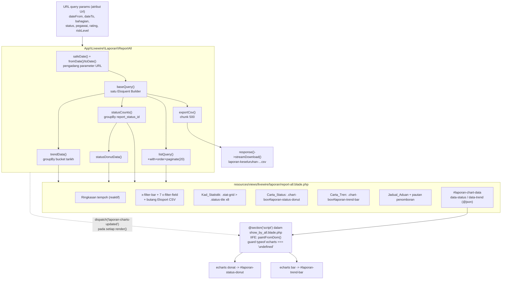
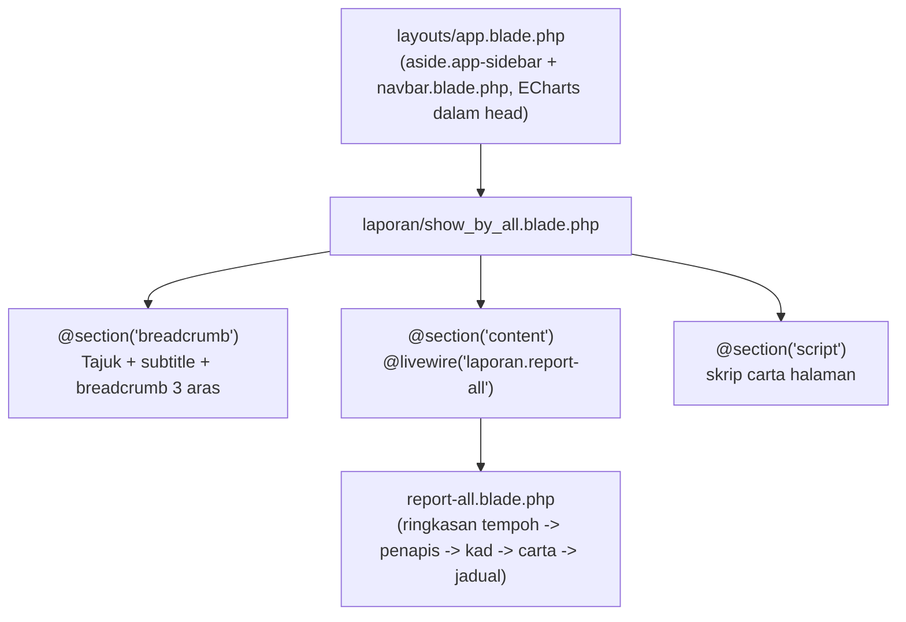

# Design Document

> **Nota penyelarasan — 2026-11-19.** Dokumen ini telah diselaraskan dengan keadaan yang
> **benar-benar dibina** selepas kumpulan tugasan 15 hingga 19 mendarat dan selepas pengguna
> menyemak halaman langsung terhadap mockup. Beberapa bahagian pada mulanya menerangkan reka
> bentuk seperti yang dirancang, dan rancangan itu berubah semasa pelaksanaan: nada Kad_Statistik
> berpindah daripada `.status-tile.bg-*` kepada kelas berskop `.stat-tone-*` beserta 24 Token_Nada
> baharu (perlanggaran `!important` Bootstrap 5.3.3 — seksyen 5.2), Legenda_Carta_Status berpindah
> daripada pilihan `legend` ECharts kepada senarai HTML dalam `.chart-split` (seksyen 4.1),
> susunan legenda dipisahkan daripada susunan Cincin_Donat (seksyen 1.4), Label_Paksi_Tarikh
> menjadi dua baris di penyemak imbas (seksyen 4.2), dan satu pepijat di luar skop dalam
> `LaporanController` dibetulkan (seksyen "Fail yang disentuh", butiran 9). Baca dokumen ini
> sebagai rekod keadaan terbina, bukan sebagai niat asal. Suite ujian pada tarikh penyelarasan:
> **498 lulus, 0 gagal** (13,664 pengesahan).

## Overview

Penambahbaikan UI/UX **Laporan Keseluruhan** (`laporan.view-by-all`) dilaksanakan sebagai
penambahan lapisan paparan di atas komponen Livewire `App\Livewire\Laporan\ReportAll` yang
sedia ada, bersama satu pengecualian kod pelayan yang diluluskan: Eksport_CSV (Requirement 11).

Reka bentuk ini berdiri atas empat fakta yang disahkan daripada kod sebenar:

1. **Satu komponen Livewire memacu keseluruhan halaman.** `ReportAll` sudah mempunyai tujuh
   sifat `#[Url]` (`dateFrom`, `dateTo`, `bahagian`, `status`, `pegawai`, `rating`, `riskLevel`),
   `mount()` yang menetapkan lalai `startOfMonth()`/`now()`, `resetFilters()`, `updated()` yang
   memanggil `resetPage()`, dan `baseQuery()` yang menggabungkan kesemua penapis. Reka bentuk ini
   **mengekalkan** kesemua ini dan menambah kaedah terbitan di atas `baseQuery()` yang sama,
   supaya Kad_Statistik, Carta_Status, Carta_Tren, Jadual_Aduan dan Eksport_CSV berkongsi satu
   sumber kebenaran (Requirement 9 kriteria 3 dan 6).
2. **Apache ECharts versi 4.3.1 sudah dimuatkan dalam `<head>`** oleh
   `resources/views/layouts/app.blade.php` (`assets/libs/echarts/echarts.min.js`), jadi ia tersedia
   sebelum skrip halaman berjalan. Tiada dependency baharu diperlukan (Requirement 9 kriteria 11).
   Versi 4.3.1 — bukan 5 — ialah kekangan yang mengikat setiap pilihan konfigurasi carta dalam reka
   bentuk ini; lihat seksyen 4.3 "Kekangan versi Pustaka_Carta" dan Requirement 9 kriteria 16.
3. **Corak carta reaktif sudah terbukti** dalam `resources/views/dashboard.blade.php` +
   `resources/views/livewire/dashboard/dashboard.blade.php`: pemegang data tersembunyi
   `<div id="dashboard-chart-data" data-*='@json(...)' hidden>` dalam view Livewire, dan satu IIFE
   dalam `@section('script')` halaman yang membaca pemegang itu, dengan pengadang
   `if (typeof echarts === 'undefined') return;`. Halaman ini meniru corak yang sama dengan
   pemegang `#laporan-chart-data`.
4. **Pangkalan data produksi ialah MySQL, suite ujian menggunakan SQLite memori.**
   `config/database.php` lalai kepada `env('DB_CONNECTION', 'mysql')`, manakala `phpunit.xml`
   menetapkan `DB_CONNECTION=sqlite` dan `DB_DATABASE=:memory:`. Fungsi tarikh SQL berbeza antara
   dua pemacu ini, jadi pengumpulan tarikh Carta_Tren mesti menggunakan ungkapan per-pemacu
   seperti `Dashboard::yearMonthExpr()` yang sudah ada.

### Pendekatan ringkas

| Bahagian | Pendekatan |
| --- | --- |
| Kepala_Halaman | Tajuk/subtitle/breadcrumb statik dalam `show_by_all.blade.php`; ringkasan tempoh reaktif dalam view Livewire |
| Penapis_Laporan | Kekal `x-filter-bar` + `x-filter-field` (tidak diubah); tambah butang Eksport CSV dalam slot `$action` |
| Kad_Statistik | Lapan kad `.status-tile` dalam grid `.stat-grid`; nada pastel `.stat-tone-*` + `.status-tile--tone` membaca 24 Token_Nada `--tone-*`, dan hue setiap kad kekal diterbitkan daripada `_report_statuses.class` |
| Carta_Status | ECharts donat (cincin sahaja) + Legenda_Carta_Status sebagai senarai HTML dalam `.chart-split`; kedua-duanya daripada satu pemegang JSON |
| Carta_Tren | ECharts bar, pengumpulan harian/bulanan ditentukan oleh ambang 62 hari; Label_Paksi_Tarikh dipecahkan dua baris oleh `formatter` penyemak imbas |
| Jadual_Aduan | Jadual Livewire sedia ada, dikemas dan ditambah lajur Bil. berlabel |
| Eksport_CSV | Tindakan `ReportAll::exportCsv()` + `App\Support\LaporanCsvExporter` (strim, 500/kelompok) |
| Sidebar_Sistem | Blok CSS **tambahan** dalam `app.css` dengan satu pengecualian yang diluluskan (warna `.app-sidebar__title`); markup `navbar.blade.php` diubah minimum |

### Fail yang disentuh

Fail 1 hingga 10 berada dalam senarai yang dibenarkan oleh Requirement 9 kriteria 8. Fail 11
berada **di luar** senarai itu dan dijejaki secara berasingan; lihat nota selepas jadual.

| # | Fail | Jenis perubahan |
| --- | --- | --- |
| 1 | `app/Livewire/Laporan/ReportAll.php` | Kaedah terbitan data carta (`statusCounts()`, `statusTone()`, `statusColorIndex()`, `statusDonutData()`, `trendData()`, `dateBucketExpr()`), pengadang tarikh, tindakan eksport |
| 2 | `resources/views/livewire/laporan/report-all.blade.php` | Tulis semula susun atur paparan; `.chart-split`, `#laporan-status-legend`, `#laporan-chart-data`, tiga tabir `.report-busy` |
| 3 | `resources/views/laporan/show_by_all.blade.php` | Kepala halaman + IIFE `@section('script')` carta |
| 4 | `resources/views/components/laporan/stat-tile.blade.php` | Komponen Blade **baharu** khusus halaman ini |
| 5 | `resources/views/components/laporan/chart-box.blade.php` | Komponen Blade **baharu** khusus halaman ini |
| 6 | `app/Support/LaporanCsvExporter.php` | Kelas eksport **baharu** (satu fail, seperti dibenarkan) |
| 7 | `resources/views/layouts/navbar.blade.php` | Hierarki visual sidebar + dua pembetulan pepijat |
| 8 | `resources/css/app.css` | Kelas baharu + 24 Token_Nada `--tone-*` baharu dalam `:root`; satu pengisytiharan sedia ada diubah nilainya, iaitu warna `.app-sidebar__title` |
| 9 | `resources/views/components/filter-bar.blade.php` | Satu prop pilihan baharu (`resetBusyTarget`) bagi butang "Set Semula" yang boleh dinyahaktifkan |
| 10 | `tests/Feature/Livewire/Laporan/` (7 fail), `tests/Feature/Laporan/` (8 fail), `tests/Unit/Support/` (1 fail) | Fail ujian **baharu**; inventori penuh dalam Testing Strategy |
| 11 | `app/Http/Controllers/LaporanController.php` | **DI LUAR SKOP.** Pembina peribadi baharu `departmentCounts()`, dikongsi oleh `viewByDepartment()` dan `laporanByDepartmentApi()` |

Lima perluasan senarai fail Requirement 9 kriteria 8 (fail ujian, warna tajuk sidebar, pembetulan
`navbar.blade.php`, suntingan `filter-bar.blade.php`, dan Token_Nada baharu dalam `:root`) telah
diluluskan pengguna dan dikodkan dalam requirements.md: Requirement 8 kriteria 3, 13 dan 14,
Requirement 9 kriteria 8, 9 dan 14, Requirement 10 kriteria 18 hingga 20, serta Keputusan Yang
Telah Diputuskan 6 hingga 9 dan 12.

**Butiran 11 — `LaporanController.php` berada di luar skop spesifikasi ini.** Requirement 9
kriteria 8 **melarang** fail ini, dan larangan itu tidak dipinda. Perubahan tersebut dijejaki
sebagai kumpulan tugasan 18 dalam tasks.md di bawah tajuk "Di Luar Skop Spesifikasi Ini — Pepijat
Bersebelahan Yang Diluluskan": pengguna meluluskan pembetulan itu semasa semakan spec ini, dan ia
dilaksanakan selepas kumpulan 1 hingga 17 selesai. Ia didokumenkan di sini supaya inventori fail
ini tidak menyembunyikan satu perubahan produksi yang sebenarnya mendarat, bukan untuk meluaskan
skop. Lihat juga "Keputusan Senarai Fail dan Reka Bentuk" butiran 12 dan nota pemacu dalam Testing
Strategy bahagian B.

## Architecture

### Aliran data



### Susunan halaman



**Mengapa tajuk statik dan ringkasan tempoh reaktif berasingan:** tajuk, subtitle dan breadcrumb
tidak bergantung kepada Set_Penapis_Semasa, jadi ia kekal dalam `@section('breadcrumb')`
`show_by_all.blade.php`. Ringkasan tempoh berubah setiap kali penapis tarikh atau Bahagian
berubah, jadi ia mesti berada di dalam DOM komponen Livewire supaya ia dimorf semula. Kedua-dua
blok dirender berturutan (`@yield('breadcrumb')` terus di atas `@yield('content')` dalam
`layouts/app.blade.php`), jadi secara visual ia satu kepala halaman. Teks "Laporan Keseluruhan"
dirender **sekali sahaja**, iaitu dalam `show_by_all.blade.php` (Requirement 1 kriteria 6).

### Mengapa skrip carta tidak dikongsi dengan dashboard

`resources/views/dashboard.blade.php` membungkus pembantu cartanya (`palette()`, `baseOption()`,
`catAxis()`, `valAxis()`, `merge()`) di dalam satu IIFE peringkat halaman, jadi pembantu itu tidak
boleh dicapai dari halaman lain. Mengekstrak pembantu tersebut ke fail JS bersama memerlukan
perubahan pada `dashboard.blade.php`, yang **dilarang** oleh Requirement 9 kriteria 8. Oleh itu
`show_by_all.blade.php` mengandungi salinan pembantu chrome carta yang sama nilainya (fon, warna,
senarai warna segmen, gaya tooltip, dan blok `legend` bawah berikon bulat dalam `baseOption()`),
seperti dituntut oleh Requirement 4 kriteria 7. Pertukaran ini disengajakan: duplikasi ~40 baris JS
ditukar dengan sifar risiko regresi pada dashboard.

Dua perkara **dikecualikan** daripada salinan itu oleh kriteria 7 sendiri: kedudukan dan susun atur
Legenda_Carta_Status (`renderDonut()` menetapkan `legend: { show: false }` dan membina senarai HTML
di sebelah cincin — lihat seksyen 4.1), dan pemetaan Palet_Carta kepada segmen (warna datang
daripada Indeks_Status, bukan daripada kedudukan segmen — kriteria 18).

## Components and Interfaces

### 1. `App\Livewire\Laporan\ReportAll` — kaedah baharu dan yang diubah

Sifat awam sedia ada (tujuh penapis `#[Url]`), `mount()`, `resetFilters()` dan `updated()`
dikekalkan. `baseQuery()` dikekalkan semantiknya dan hanya ungkapan tarikhnya dialihkan kepada
pembantu baharu.

#### 1.1 Pengadang parameter URL

Masalah sebenar: `baseQuery()` kini memanggil `Carbon::parse($this->dateFrom)` secara terus.
URL yang disunting tangan seperti `?dateFrom=abc` menyebabkan `Carbon` membuang
`Carbon\Exceptions\InvalidFormatException`, iaitu ralat pelayan 500 — bercanggah dengan
Requirement 2 kriteria 9 dan Requirement 9 kriteria 13.

```php
/**
 * Tarikh Y-m-d yang selamat. Nilai yang bukan Y-m-d sah (URL disunting
 * tangan) jatuh kembali kepada $fallback, tanpa pengecualian.
 */
protected function safeDate(string $value, Carbon $fallback): Carbon;
// Pelaksanaan: Carbon::hasFormat($value, 'Y-m-d') ? Carbon::createFromFormat('Y-m-d', $value) : $fallback

protected function fromDate(): Carbon;   // safeDate($this->dateFrom, now()->startOfMonth())->startOfDay()
protected function toDate(): Carbon;     // safeDate($this->dateTo, now())->endOfDay()

/** Nilai Y-m-d yang telah dibersihkan, untuk paparan dan nama fail eksport. */
protected function normalisedFrom(): string;   // fromDate()->format('Y-m-d')
protected function normalisedTo(): string;     // toDate()->format('Y-m-d')

/** Julat_Tarikh_Tidak_Sah: Dari Tarikh lebih lewat daripada Hingga Tarikh. */
public function hasInvalidRange(): bool;       // fromDate()->gt(toDate())
```

Nilai sifat awam **tidak** ditulis semula oleh pengadang ini (Requirement 1 kriteria 9,
Requirement 2 kriteria 10: nilai yang dimasukkan dikekalkan dalam kawalan dan URL). Pembersihan
hanya berlaku pada titik penggunaan.

Penapis bukan tarikh (`status`, `pegawai`, `rating`, `riskLevel`) sudah selamat: `baseQuery()`
menghantarnya melalui hantaran `(int)`, jadi nilai bukan angka menjadi `0` dan memadankan sifar
rekod — itulah keadaan kosong yang dituntut oleh Requirement 9 kriteria 13, bukan ralat. View
memaparkan kawalan pada nilai lalai apabila nilai tidak terdapat dalam senarai pilihan, kerana
`<select>` HTML tanpa `<option>` sepadan jatuh kepada pilihan pertama (`value=""`).

#### 1.2 Satu pertanyaan asas untuk semua pengguna data

```php
/** Pertanyaan asas dengan tujuh penapis — tidak diubah semantiknya. */
protected function baseQuery(): \Illuminate\Database\Eloquent\Builder;

/**
 * Pertanyaan senarai: baseQuery + eager load + susunan muktamad.
 * Dikongsi oleh Jadual_Aduan dan Eksport_CSV supaya kedua-duanya
 * menghasilkan baris yang sama dalam susunan yang sama.
 */
protected function listQuery(): \Illuminate\Database\Eloquent\Builder;
// baseQuery()->with(['status','category','riskLevel','reportBy'])
//            ->orderByDesc('submitted_at')->orderByDesc('id')
```

**Keputusan reka bentuk — penambah susunan `id` menurun.** `submitted_at` bukan unik (aduan boleh
dihantar dalam saat yang sama, dan penyemaian demo menetapkan nilai yang sama). Tanpa pemecah
seri, (a) susunan antara baris bertarikh sama tidak ditentukan, jadi `chunk()` eksport boleh
melangkau atau mengulang baris, dan (b) gabungan halaman Jadual_Aduan tidak dijamin sama dengan
set eksport. Menambah `orderByDesc('id')` menjadikan susunan jumlah (total order). Ini **tidak**
mengubah semantik yang disenaraikan dalam Requirement 9 kriteria 3; ia hanya menetapkan susunan
dalam kumpulan baris yang `submitted_at`-nya seiras. Lihat juga "Keputusan Senarai Fail dan Reka
Bentuk" butiran 7.

#### 1.3 Kad_Statistik

```php
/**
 * Bilangan per status untuk kesemua tujuh status COUNTED, menaik id.
 * @return array<int, array{id:int, desc:string, class:string, tone:string, icon:string, total:int}>
 */
protected function statusCounts(): array;

/**
 * Nada kad: token `bg-*` pertama dalam kelas badge status, contoh
 * "badge bg-warning" -> "bg-warning". Fallback: 'bg-secondary'.
 */
protected function statusTone(?string $class): string;
```

- Satu pertanyaan agregat: `(clone $this->baseQuery())->select('report_status_id', DB::raw('count(*) as total'))->groupBy('report_status_id')->pluck('total','report_status_id')` — corak yang sama seperti `render()` sekarang.
- Dipetakan ke atas `ReportStatus::whereIn('id', ReportStatuses::COUNTED)->orderBy('id')->get()`, jadi status tanpa aduan tetap muncul dengan `total = 0` (Requirement 3 kriteria 9).
- `tone` ialah kelas `bg-*` pertama yang diekstrak daripada `_report_statuses.class` oleh `statusTone()` (contoh `badge bg-warning` → `bg-warning`), logik yang sama seperti blok `@php` dalam view sekarang, dipindahkan ke komponen supaya view tidak mengandungi pemetaan warna (Requirement 3 kriteria 6). Token itu dinamakan semula kepada `stat-tone-warning` oleh `stat-tile.blade.php` — penggantian rentetan tulen, bukan pemetaan warna per-status; lihat seksyen 5.1 dan 5.2.
- `icon` diambil daripada satu peta ikon **mengikut id status** dalam komponen:

```php
/** Ikon Bootstrap Icons per status. Berbeza bagi ketujuh status. */
protected const STATUS_ICONS = [
    ReportStatuses::BARU             => 'bi-inbox',
    ReportStatuses::DISEMAK          => 'bi-clipboard-check',
    ReportStatuses::DALAM_TINDAKAN   => 'bi-hourglass-split',
    ReportStatuses::SELESAI          => 'bi-check2-circle',
    ReportStatuses::KIV              => 'bi-pause-circle',
    ReportStatuses::SELESAI_TINDAKAN => 'bi-clipboard2-check',
    ReportStatuses::TINDAKAN_LANJUT  => 'bi-exclamation-triangle',
];
protected function statusIcon(int $statusId): string;   // fallback: 'bi-circle'
```

**Mengapa ikon dipetakan mengikut id, bukan diterbitkan daripada `class`:** nilai
`_report_statuses.class` **tidak unik** — penyemai memberi `badge bg-warning` kepada *Dalam
Tindakan* dan *KIV*, dan `badge bg-success` kepada *Selesai* dan *Selesai Tindakan*. Oleh itu
`class` tidak boleh menghasilkan tujuh ikon berbeza seperti dituntut Requirement 3 kriteria 5.
Peta id→ikon ialah data persembahan, bukan bilangan atau label, jadi ia tidak melanggar
Requirement 9 kriteria 6. Status baharu yang ditambah di pangkalan data mendapat ikon fallback
dan warna yang betul daripada `class`-nya.

`grandTotal` dikekalkan sebagai hasil tambah agregat yang sama (`$summary->sum()`), jadi kad
Jumlah dan tujuh kad status sentiasa berasal daripada satu pertanyaan.

#### 1.4 Carta_Status (donat)

```php
/** Indeks_Status: kedudukan status dalam ReportStatuses::COUNTED (menaik id), 0-6. */
protected function statusColorIndex(int $statusId): int;

/**
 * @return array{
 *   total:int,
 *   segments:array<int, array{id:int, label:string, value:int, percent:float, colorIndex:int}>,
 *   legend:array<int, array{id:int, label:string, value:int, percent:float, colorIndex:int}>
 * }
 */
protected function statusDonutData(?array $statusCounts = null): array;
```

- Dibina **daripada `statusCounts()`**, bukan pertanyaan tambahan — jadi segmen donat dan kad statistik tidak boleh berbeza.
- **Dua senarai, kerana Cincin_Donat dan Legenda_Carta_Status menjawab soalan yang berbeza:**
  - `segments` — Cincin_Donat. Hanya status dengan `total > 0` (Requirement 4 kriteria 1), susunan menaik id dikekalkan. Status berbilangan 0 tiada hirisan untuk dilukis.
  - `legend` — baris Legenda_Carta_Status. Kesemua **tujuh** status `ReportStatuses::COUNTED` termasuk yang bilangannya 0, disusun **menurun mengikut bilangan** dengan seri dipecahkan **menaik mengikut id** (Requirement 4 kriteria 15 dan 16), jadi susunan bagi satu Set_Penapis_Semasa adalah tunggal dan sama pada setiap render. Diatur dengan `usort` yang membandingkan `[$b['value'], $a['id']] <=> [$a['value'], $b['id']]`.
- `colorIndex` ialah **Indeks_Status**, dibawa oleh kedua-dua senarai supaya penyemak imbas memberikan warna **per status** dan bukan per kedudukan senarai (Requirement 4 kriteria 17 hingga 19). Tanpanya, susunan menurun kriteria 15 akan menukar warna satu status setiap kali bilangannya berubah kedudukan, dan titik legenda tidak akan sepadan dengan segmen cincin status yang sama.
- `percent` = `round($value / $total * 100, 1)`, dikira di pelayan supaya pelayar dan CSV tidak perlu mengira semula; entri berbilangan 0 membawa `percent` 0.0 dan dirender sebagai "(0.0%)".
- `total` sama dengan `grandTotal`, dan ia dirender di tengah cincin di bawah label **"Jumlah Tiket"** (Requirement 4 kriteria 2).
- Apabila `total === 0`, **kedua-dua** `segments` dan `legend` ialah tatasusunan kosong: view memaparkan keadaan kosong tanpa memulakan carta, tanpa nilai tengah dan tanpa legenda (Requirement 4 kriteria 6) — itulah sebabnya peraturan tujuh baris kriteria 16 hanya terpakai apabila jumlah >= 1.
- Senarai `legend` dikawal oleh **Property 28**.

#### 1.5 Carta_Tren (bar)

```php
/** 'day' apabila julat <= 62 hari inklusif, 'month' apabila lebih. */
protected function trendGranularity(): string;

/** Bilangan baldi yang dijangka bagi julat semasa — fungsi tulen julat tarikh. */
protected function trendBucketCount(): int;

/**
 * @return array{
 *   granularity:string,          // 'day'|'month'
 *   labels:array<int,string>,    // "03 Mac" | "Mac 2025"
 *   values:array<int,int>,       // bilangan aduan per baldi, termasuk 0
 *   total:int                    // hasil tambah values
 * }
 */
protected function trendData(): array;

/** Ungkapan SQL per-pemacu untuk kunci baldi tarikh. */
protected function dateBucketExpr(string $column, string $granularity): string;
```

Peraturan granulariti (Requirement 5 kriteria 3 dan 4), dikira secara inklusif kedua-dua hujung:

```
spanDays = fromDate()->diffInDays(toDate()) + 1
granularity = spanDays <= 62 ? 'day' : 'month'
```

#### 1.6 Eksport_CSV

```php
/**
 * Muat turun CSV bagi keseluruhan set hasil yang ditapis.
 * Mengembalikan null apabila tiada rekod (tiada muat turun; mesej dipaparkan).
 */
public function exportCsv(): ?\Symfony\Component\HttpFoundation\StreamedResponse;

/** Mesej sebaris selepas percubaan eksport tanpa data. */
public string $exportNotice = '';
```

Urutan dalam `exportCsv()`:

1. `$this->authorize('access-main-dashboard')` — lapisan kebenaran ketiga, selain pengadang laluan dan `mount()` (Requirement 11 kriteria 11 dan 12).
2. `$count = (clone $this->baseQuery())->count();`
3. Jika `$count === 0`: `$this->exportNotice = 'Tiada data untuk dieksport.'; return null;` (Requirement 11 kriteria 16 dan 17 — julat tidak sah menghasilkan 0 rekod secara semula jadi, jadi laluan yang sama melindunginya tanpa cabang tambahan).
4. `$this->exportNotice = '';` kemudian `return LaporanCsvExporter::stream($this->listQuery(), $this->exportFilename());`

`exportNotice` dikosongkan dalam `updated()` bersama panggilan `resetPage()` yang sedia ada, supaya
mesej tidak melekat selepas penapis berubah. `exportCsv()` tidak menyentuh mana-mana sifat penapis
dan tidak memanggil `resetPage()`, jadi Set_Penapis_Semasa, nombor halaman, kad dan carta kekal
(Requirement 11 kriteria 15).

```php
/** laporan-keseluruhan-2026-01-01-hingga-2026-01-31.csv */
protected function exportFilename(): string;
```

#### 1.7 `render()`

`render()` kekal sebagai satu-satunya titik yang menghantar data ke view, dan kini juga menghantar
isyarat kemas kini carta:

```php
public function render()
{
    $statusCounts = $this->statusCounts();
    ...
    $this->dispatch('laporan-charts-updated');   // isyarat tanpa payload

    return view('livewire.laporan.report-all', [
        'reports'          => $this->listQuery()->paginate(20),
        'statusCounts'     => $statusCounts,
        // Alias nama lama bagi tatasusunan yang SAMA. Markup kad asal dan
        // tests/Feature/ReportTotalsTest.php membaca 'summary', dan barisnya
        // ialah superset kunci desc/class/total yang digunakan ujian itu,
        // jadi alias ini yang mengekalkan Requirement 9 kriteria 10.
        'summary'          => $statusCounts,
        'grandTotal'       => $grandTotal,
        // statusCounts DIHANTAR MASUK: donat tidak menjalankan agregatnya
        // sendiri, jadi halaman berharga satu pertanyaan status sahaja dan
        // segmen tidak boleh bercanggah dengan kad.
        'donut'            => $this->statusDonutData($statusCounts),
        'trend'            => $this->trendData(),
        'invalidRange'     => $this->hasInvalidRange(),
        'periodFrom'       => $this->normalisedFrom(),
        'periodTo'         => $this->normalisedTo(),
        'bahagianOptions'  => ...,   // tidak diubah
        'statusOptions'    => ...,   // tidak diubah
        'pegawaiOptions'   => ...,   // tidak diubah
        'riskLevelOptions' => ...,   // tidak diubah
    ]);
}
```

**Mengapa isyarat tanpa payload:** Requirement 5 kriteria 10 menetapkan data carta dihantar
melalui pemegang data JSON `data-*` dalam view. Jika `dispatch()` juga membawa payload, akan ada
dua sumber kebenaran yang boleh berbeza. Peristiwa ini hanya memberitahu skrip "pemegang data
sudah segar, baca semula", jadi pemegang JSON kekal satu-satunya pengangkut data.

### 2. `App\Support\LaporanCsvExporter` (fail baharu)

```php
final class LaporanCsvExporter
{
    /** Sembilan lajur Jadual_Aduan tanpa lajur Tindakan. */
    public const HEADERS = ['Bil.','Tiket','Subjek','Bahagian','Kategori','Risiko','Tarikh','Status','Rating'];

    /** Saiz kelompok strim. */
    public const CHUNK_SIZE = 500;

    /** Penanda sel kosong (Requirement 11 kriteria 7). */
    private const BLANK = '-';

    /**
     * Strim CSV UTF-8 (dengan BOM) daripada pertanyaan yang diberi.
     * Pertanyaan mesti sudah ditapis dan disusun **sepenuhnya** oleh
     * pemanggil — jangan susun semula di sini.
     */
    public static function stream(Builder $query, string $filename): StreamedResponse;

    /** Satu baris data CSV bagi satu aduan. */
    public static function row(Report $report, int $bil): array;

    /**
     * Satu baris dengan tetapan CSV EKSPLISIT: pemisah koma, pengapit
     * petikan berganda, aksara escape kosong.
     *
     * Argumen ketiga dan keempat memenuhi Requirement 11 kriteria 8 secara
     * literal, manakala escape kosong ialah CSV RFC 4180 tulen — itulah yang
     * dihurai oleh aplikasi hamparan, dan ia juga mengunci satu-satunya
     * argumen `fputcsv()` yang nilai lalainya berubah antara versi PHP.
     * Dengan tetapan ini, medan yang mengandungi koma, petikan berganda atau
     * baris baharu round-trip melalui `str_getcsv()` tanpa berubah.
     */
    private static function write($handle, array $row): void;
    // fputcsv($handle, $row, ',', '"', '');

    /** Sel teks, atau BLANK apabila nilainya kosong selepas `trim()`. */
    private static function text(?string $value): string;

    /** Rating sebagai integer 1..5 mentah; kosong dan 0 kedua-duanya BLANK. */
    private static function rating($value): int|string;
}
```

### 3. Komponen Blade baharu (khusus halaman ini)

```blade
{{-- resources/views/components/laporan/stat-tile.blade.php --}}
@props(['label', 'value', 'tone' => 'bg-secondary', 'icon' => 'bi-circle', 'total' => false])

{{-- resources/views/components/laporan/chart-box.blade.php --}}
@props(['id', 'empty' => false, 'emptyText' => 'Tiada data untuk tempoh ini'])
```

`chart-box` merender bekas berketinggian tetap, keadaan kosong pelayan, dan mesej fallback
pustaka carta yang tersembunyi — jadi ketiga-tiga keadaan berkongsi ketinggian yang sama
(Requirement 7 kriteria 5).

`x-filter-field` digunakan **tanpa diubah**. Butang Eksport CSV masuk melalui slot `$action` yang
sudah disediakan oleh `filter-bar.blade.php`, dan butang "Set Semula" datang daripada
`:show-reset="true"` yang sudah digunakan — kedua-duanya berada dalam
`div.d-flex.align-items-center.gap-2` yang sama, dengan Set Semula dahulu (Requirement 2
kriteria 12).

#### 3.1 Suntingan `filter-bar.blade.php` (diluluskan)

Komponen `x-filter-bar` dikongsi oleh sembilan view lain, jadi suntingan direka supaya ia
**tiada kesan** apabila prop baharu tidak diberi nilai (Requirement 8 kriteria 13).

```blade
@props([
    'title' => 'Penapis',
    'icon' => 'bi-funnel',
    'showReset' => false,
    'resetAction' => 'resetFilters',
    'resetBusyTarget' => null,   {{-- BAHARU: senarai wire:target bagi keadaan memuat --}}
    'action' => null,
])
...
<button type="button" class="btn btn-sm btn-outline-secondary"
        wire:click="{{ $resetAction }}"
        @if ($resetBusyTarget)
            wire:loading.attr="disabled" wire:target="{{ $resetBusyTarget }}"
        @endif>
```

Apabila `resetBusyTarget` ialah `null` (kesemua sembilan pemanggil lain), Blade tidak memancarkan
sebarang atribut tambahan dan markup yang terhasil **sama bait-demi-bait** seperti sebelum ini.
`report-all.blade.php` menghantar `:reset-busy-target="$busy"` menggunakan senarai sasaran yang
sama seperti tindanan memuat, jadi butang menerima atribut `disabled` sebenar semasa setiap
permintaan penapis, penomboran atau Set Semula.

### 4. Skrip carta dalam `show_by_all.blade.php`

Struktur mengikut `dashboard.blade.php`: satu IIFE dalam `@section('script')`, pembantu chrome
dalaman, dan `paintFromDom()` yang membaca pemegang data.

```js
@section('script')
<script>
(function () {
    function cssVar(name, fallback) { /* sama seperti dashboard */ }
    function palette() { /* senarai warna segmen yang SAMA, susunan yang SAMA */
        return { list: ['#6b78dc', '#f0c86f', '#9ba7ec', '#8ed0c6',
                        '#c3a7e6', '#ef9f9f', '#7fb3e0', '#d9c9a0'] };
    }
    var FONT = "'Figtree', system-ui, sans-serif";
    var FONT_NUM = "'Sora', 'Figtree', system-ui, sans-serif";
    var INK = '#1c2138', MUTED = '#6a7089', HAIRLINE = '#e9ecf9';
    function baseOption() { /* textStyle + tooltip + legend seperti dashboard */ }
    function catAxis(data, opts) { /* seperti dashboard */ }
    function valAxis(opts) { /* seperti dashboard, minInterval: 1 */ }
    function merge(extra) { /* seperti dashboard */ }
    var CHART_IDS = ['laporan-status-donut', 'laporan-trend-bar'];

    function fmt(n) { return Number(n || 0).toLocaleString('en-US'); }  // pemisah ribuan
    function pct(v) { return Number(v || 0).toFixed(1); }  // FORMAT sahaja, tiada kiraan semula
    function twoLineLabel(value) { /* "01 Nov" -> "01\nNov"; lihat 4.2 */ }

    // Elemen fallback diselesaikan MELALUI sasaran carta, bukan terus melalui
    // id "{id}-fallback": dalam keadaan kosong pelayan, chart-box tidak
    // merender sasaran carta sama sekali, jadi "tiada sasaran" bermakna
    // "tiada apa-apa yang gagal" dan fungsi keluar awal. Tanpa pengadang ini
    // tindanan legap .chart-fallback akan menutup keadaan kosong yang sah
    // dengan mesej "Carta tidak dapat dipaparkan." yang mengelirukan.
    function fallbackEl(id) { /* target -> closest('.chart-box') -> .chart-fallback */ }
    function showFallback(id) { /* fallbackEl(id).classList.add('is-shown') */ }
    function hideFallback(id) { /* dipanggil oleh setiap lukisan yang BERJAYA */ }

    // Saiz fon nilai tengah donat dikira daripada sisi terkecil bekas
    // (26/22/19/16px), kerana lubang donat ialah peratusan daripada bekas dan
    // donat berkongsi lebar dengan legenda pada >=992px.
    function centreFontSize(el) { /* lihat 4.1 */ }

    function renderStatusLegend(donut, colors) { /* lihat di bawah */ }
    function statusColor(colors, entry, fallbackIndex) { /* lihat di bawah */ }
    function renderDonut(donut) { /* lihat di bawah */ }
    function renderTrend(trend) { /* lihat di bawah */ }

    function paintFromDom() {
        if (typeof echarts === 'undefined') { CHART_IDS.forEach(showFallback); return; }
        var el = document.getElementById('laporan-chart-data');
        if (!el) return;
        try {
            renderDonut(JSON.parse(el.dataset.status || 'null'));
            renderTrend(JSON.parse(el.dataset.trend || 'null'));
        } catch (e) {
            CHART_IDS.forEach(showFallback);
        }
    }

    document.addEventListener('DOMContentLoaded', paintFromDom);
    document.addEventListener('livewire:navigated', paintFromDom);
    paintFromDom();

    // Setiap render() ReportAll menghantar isyarat ini; skrip membaca
    // SEMULA pemegang data (bukan payload peristiwa), jadi pemegang JSON
    // kekal satu-satunya pengangkut data.
    document.addEventListener('livewire:init', function () {
        Livewire.on('laporan-charts-updated', paintFromDom);
    });

    // Resize dua peringkat: `resize()` serta-merta supaya carta mengikut
    // bekas tanpa lengahan, kemudian satu `paintFromDom()` yang dilengahkan
    // 200ms selepas resize reda. Lukisan semula itu diperlukan kerana
    // centreFontSize() dikira daripada lebar bekas dan hanya boleh dikira
    // semula melalui setOption.
    var resizeTimer = null;
    window.addEventListener('resize', function () {
        if (typeof echarts === 'undefined') return;
        CHART_IDS.forEach(/* echarts.getInstanceByDom(el).resize() */);
        if (resizeTimer) clearTimeout(resizeTimer);
        resizeTimer = setTimeout(paintFromDom, 200);
    });
})();
</script>
@endsection
```

#### 4.1 Objek pilihan Carta_Status (donat)

```js
function renderDonut(donut) {
    var el = document.getElementById('laporan-status-donut');
    if (!el || !donut || !donut.segments || !donut.segments.length) return;

    var total = donut.total;
    var colors = palette().list;
    var percents = {};   // peta nama -> peratus pelayan; pct() hanya memformatnya
    donut.segments.forEach(function (s) { percents[s.label] = s.percent; });

    // Warna EKSPLISIT per item, daripada colorIndex status itu sendiri.
    var rows = donut.segments.map(function (s, i) {
        return { name: s.label, value: s.value,
                 itemStyle: { color: statusColor(colors, s, i) } };
    });

    var totalSize = centreFontSize(el);

    var chart = echarts.getInstanceByDom(el) || echarts.init(el);
    chart.setOption(merge({
        // TIADA `color: palette().list` di sini: tatasusunan itu memetakan
        // warna mengikut KEDUDUKAN segmen.
        tooltip: {
            trigger: 'item',
            formatter: function (p) {
                return '<strong>' + p.name + '</strong><br>' +
                       fmt(p.value) + ' aduan (' + pct(percents[p.name]) + '%)';
            }
        },
        // Legenda ECharts dimatikan sepenuhnya: Legenda_Carta_Status ialah
        // senarai HTML di sebelah cincin (lihat renderStatusLegend).
        legend: { show: false },
        series: [{
            type: 'pie', radius: ['58%', '74%'], center: ['50%', '50%'],
            avoidLabelOverlap: true,
            itemStyle: { borderColor: '#fff', borderWidth: 2 },
            label: {
                show: true, position: 'center',
                formatter: '{v|' + fmt(total) + '}\n{l|Jumlah Tiket}',
                rich: {
                    v: { fontFamily: FONT_NUM, fontSize: totalSize, fontWeight: 600, color: INK, lineHeight: totalSize + 6 },
                    l: { fontFamily: FONT, fontSize: 11, color: MUTED, letterSpacing: 1 }
                }
            },
            emphasis: { label: { show: true }, scale: false },
            labelLine: { show: false },
            data: rows
        }]
    }), true);
    chart.resize();
    renderStatusLegend(donut, colors);
    // Lukisan yang berjaya membuang mesej fallback, supaya satu muatan JSON
    // yang rosak tidak meninggalkan mesej yang melekat selepas penapis
    // seterusnya berjaya dirender.
    hideFallback('laporan-status-donut');
}

// Warna_Status = Palet_Carta pada Indeks_Status, bukan pada kedudukan senarai.
function statusColor(colors, entry, fallbackIndex) {
    var i = entry && typeof entry.colorIndex === 'number' ? entry.colorIndex : fallbackIndex;
    return colors[i % colors.length];
}

// Legenda_Carta_Status: senarai HTML di SEBELAH cincin, satu baris bagi
// setiap satu daripada tujuh status, susunan datang daripada pelayan.
function renderStatusLegend(donut, colors) {
    var box = document.getElementById('laporan-status-legend');
    if (!box) return;

    box.textContent = '';

    (donut.legend && donut.legend.length ? donut.legend : donut.segments)
        .forEach(function (s, i) {
            // .chart-legend__dot  — warna per status (statusColor)
            // .chart-legend__name — nama, dipendekkan oleh CSS + title penuh
            // .chart-legend__value— fmt(s.value), dijajarkan kanan
            // .chart-legend__pct  — '(' + pct(s.percent) + '%)'
        });
}
```

Nilai tengah menggunakan `fmt(total)` (pemisah ribuan) dengan label **"Jumlah Tiket"** pada baris
kedua di bawahnya melalui `rich` ECharts (Requirement 4 kriteria 2); `totalSize` dikira daripada
sisi terkecil bekas supaya nombor kekal dalam lubang donat pada kad yang berkongsi lebar dengan
legenda. Peratus datang daripada pelayan, jadi legenda, tooltip dan mana-mana pengiraan lain tidak
boleh berbeza (Requirement 4 kriteria 3 dan 8).

**Legenda ialah senarai HTML, bukan `legend` ECharts.** Legenda ECharts 4.3.1 tiada pemendekan
teks per-token, jadi lajur berlebar tetap akan melimpah dan merosakkan tepi kanan yang dikongsi
(Requirement 4 kriteria 11 dan 13). Oleh itu `legend: { show: false }`, dan baris dibina melalui
DOM API (`textContent`, bukan `innerHTML`, kerana nama status datang daripada pangkalan data)
dalam bekas `#laporan-status-legend` di dalam `.chart-split` — di **sebelah** cincin pada >=992px
dan di **bawahnya** pada <=991px, bukan sebagai jalur legenda mendatar (kriteria 10 dan 12).
Susunan baris ialah susunan `donut.legend` yang dihantar pelayan: menurun mengikut bilangan, tujuh
baris termasuk yang bilangannya 0 (kriteria 15 dan 16). Tiada pengurutan dalam penyemak imbas.

**Warna dipisahkan daripada kedudukan.** Oleh kerana susunan baris legenda (menurun mengikut
bilangan) berbeza daripada susunan segmen cincin (menaik mengikut id), pemetaan palet mengikut
kedudukan akan memberikan satu status dua warna berbeza pada halaman yang sama dan menukar
warnanya setiap kali bilangannya berubah kedudukan. Jadi warna diberikan secara eksplisit melalui
`itemStyle.color` pada setiap item data pie dan pada setiap `.chart-legend__dot`, kedua-duanya
daripada `colorIndex` (Indeks_Status) status itu sendiri (kriteria 17 hingga 19).

**Peratusan berkurungan.** Setiap baris merender `'(' + pct(s.percent) + '%)'`, iaitu `(38.5%)`
dan bukan `38.5%` (Requirement 4 kriteria 20). `pct()` hanya **memformat** nilai `percent` yang
dihantar pelayan kepada satu tempat perpuluhan; tiada pengiraan peratus dalam penyemak imbas, jadi
legenda, tooltip dan kad tidak boleh menghasilkan nombor yang berbeza (kriteria 3 dan 8).

**Bekas legenda dalam markup.** `#laporan-status-legend` berada dalam `.chart-split` bersama
`x-laporan.chart-box`, dan dua perkara padanya ialah keputusan reka bentuk:

- Ia dirender di bawah `@unless ($donutEmpty)`. Jumlah sifar bermakna tiada segmen **dan** tiada bekas legenda sama sekali, bukan bekas kosong di sebelah mesej keadaan kosong (Requirement 4 kriteria 6). `.chart-legend:empty { display: none }` ialah jaring keselamatan kedua bagi keadaan di mana bekas hadir tetapi skrip tidak pernah berjalan.
- Ia membawa `wire:ignore`. Kandungannya dibina oleh skrip carta, bukan oleh Blade, jadi morph Livewire tidak boleh mengosongkannya pada setiap render — baris legenda terdahulu kekal kelihatan sehingga `laporan-charts-updated` melukisnya semula, tanpa kilatan kosong di antaranya. Atribut `data-status` pemegang JSON **tidak** diabaikan, jadi sumber data legenda masih mengikut penapis pada setiap render; itu yang disahkan oleh `test_the_ignored_legend_is_server_empty_and_its_data_source_follows_the_filters`.

#### 4.2 Objek pilihan Carta_Tren (bar)

```js
function renderTrend(trend) {
    var el = document.getElementById('laporan-trend-bar');
    if (!el || !trend || !trend.labels || !trend.labels.length) return;

    var p = palette();
    var chart = echarts.getInstanceByDom(el) || echarts.init(el);
    chart.setOption(merge({
        tooltip: {
            trigger: 'axis', axisPointer: { type: 'shadow' },
            formatter: function (params) {
                if (!params.length) return '';
                return '<strong>' + params[0].name + '</strong><br>' +
                       fmt(params[0].value) + ' aduan';
            }
        },
        legend: { show: false },
        // `containLabel: true` bermakna `bottom` ialah jarak dari tepi bawah
        // bekas ke tepi BAWAH label paksi, bukan ke garis paksi. Jadi
        // ketinggian label dua baris (2 x lineHeight 15 = 30px) diserap oleh
        // grid dengan sendirinya dan 28px di bawahnya kekal ruang lapang —
        // paksi dua baris tidak boleh terpotong oleh tepi `.chart-box`
        // (Requirement 5 kriteria 14 dan 15).
        grid: { left: 8, right: 20, top: 16, bottom: 28, containLabel: true },
        xAxis: catAxis(trend.labels, {
            axisLabel: {
                color: MUTED, fontFamily: FONT,
                // Pelangkauan automatik pada **setiap** bilangan baldi: ECharts
                // 4.3.1 mengira sendiri selang tetap yang muat pada lebar paksi.
                // `interval: labels.length > 31 ? 'auto' : 0` yang dahulu
                // memaksa setiap label dilukis pada <=31 baldi, dan itulah
                // punca "01 No02 No03 No" pada julat 15 hari. `hideOverlap`
                // TIDAK digunakan: pilihan itu hanya wujud dari ECharts 5
                // (lihat "Kekangan versi Pustaka_Carta" di bawah).
                interval: 'auto',
                // ECharts mengira selang langkauan daripada label yang TELAH
                // diformat, jadi pemecahan dua baris mengecilkan lebar yang
                // diukur daripada "01 Nov" kepada "Nov" — lebih banyak label
                // kekal dapat dipaparkan sebelum langkauan diperlukan.
                formatter: twoLineLabel,   // "01 Nov" -> "01\nNov"
                lineHeight: 15
            }
        }),
        yAxis: valAxis(),            // minInterval: 1, bermula 0, integer
        series: [{
            type: 'bar', barMaxWidth: 28,
            itemStyle: {
                borderRadius: [8, 8, 0, 0],
                color: new echarts.graphic.LinearGradient(0, 0, 0, 1, [
                    { offset: 0, color: '#6b78dc' }, { offset: 1, color: p.list[2] }])
            },
            data: trend.values
        }]
    }), true);
    chart.resize();
    hideFallback('laporan-trend-bar');
}

// Pemisah ialah RUANG PERTAMA, jadi satu fungsi mengendalikan kedua-dua
// format pelayan tanpa mengetahui granulariti:
//   "01 Nov"   -> "01"  / "Nov"
//   "Nov 2025" -> "Nov" / "2025"
function twoLineLabel(value) {
    var text = value == null ? '' : String(value);
    var gap = text.indexOf(' ');
    return gap === -1 ? text : text.slice(0, gap) + '\n' + text.slice(gap + 1);
}
```

`setOption(..., true)` (notMerge) pada kedua-dua carta membuang sepenuhnya siri sebelumnya, jadi
tiada segmen atau bar daripada Set_Penapis_Semasa terdahulu kekal (Requirement 4 kriteria 5,
Requirement 5 kriteria 8).

**Rentetan label pelayan sengaja TIDAK diubah.** `trendData()` terus menjana `"03 Mac"` dan
`"Mac 2026"` seperti sebelum ini. Pemecahan dua baris berlaku **pada masa melukis**, dalam
`formatter` penyemak imbas, kerana dua sebab yang mengikat: `tests/Feature/Livewire/Laporan/ReportAllTrendDataTest.php`
mengesahkan format rentetan pelayan itu dan Requirement 9 kriteria 10 melarang pengesahan sedia
ada dilemahkan, dan Requirement 5 kriteria 16 memang menuntut pemecahan berlaku di lapisan
paparan. Akibatnya: `data-trend` dalam pemegang JSON membawa label satu baris, dan hanya paksi
yang dilukis membawa dua baris — itu bukan percanggahan.

#### 4.3 Kekangan versi Pustaka_Carta

Fail pustaka yang dibundalkan ialah **ECharts 4.3.1**, bukan 5 — `public/assets/libs/echarts/echarts.min.js`
mengandungi rentetan `version:"4.3.1"`. Fakta ini ditemui semasa tugasan 15.2 dan mengubah dua
perkara dalam reka bentuk ini:

1. **`axisLabel.hideOverlap` tidak berfungsi.** Pilihan tersebut diperkenalkan dalam ECharts 5.
   Versi 4.3.1 mengabaikannya tanpa ralat, jadi versi awal reka bentuk ini (dan tugasan 9.3) salah
   apabila mempersembahkannya sebagai perlindungan terhadap pertindihan Label_Paksi_Tarikh.
   Perlindungan yang sebenar ialah dua perkara bersama: `interval: 'auto'` pada setiap bilangan
   baldi (pengiraan selang terbina ECharts 4, disahkan secara aritmetik jelas pada 15, 31 dan 62
   baldi), dan `formatter: twoLineLabel` yang mengecilkan lebar label yang DIUKUR oleh pengiraan
   itu daripada `"01 Nov"` kepada `"Nov"`.
2. **Legenda donat dibina dalam DOM, bukan dalam pilihan ECharts.** Legenda ECharts 4.3.1 tiada
   pemendekan teks per-token, jadi lajur berlebar tetap melimpah dan merosakkan tepi kanan yang
   dikongsi oleh Requirement 4 kriteria 11. Lihat seksyen 4.1.

**Keadaan terbina:** `hideOverlap` **tidak hadir** sebagai pilihan konfigurasi di mana-mana dalam
`app/`, `resources/` atau `tests/`. Satu-satunya kemunculan rentetan itu dalam pepohon sumber ialah
komen amaran dalam `renderTrend()` yang menerangkan sebab ia tiada, supaya pilihan tersebut tidak
dimasukkan semula oleh penyelenggara akan datang. Skrip carta halaman ini **tidak boleh**
menggunakan pilihan khusus ECharts 5 (`axisLabel.hideOverlap`, `series.labelLayout`, dan
seumpamanya) — Requirement 9 kriteria 16. Menaik taraf pustaka berada di luar skop: Requirement 9
kriteria 11 melarang fail pustaka baharu dalam `public/assets/libs`, dan pustaka itu dikongsi oleh
dashboard.

### 5. Kelas CSS baharu dalam `resources/css/app.css`

Semua kelas di bawah ialah **blok baharu yang ditambah**. Satu-satunya pengisytiharan sedia ada
yang nilainya ditukar ialah warna `.app-sidebar__title` (pengecualian yang diluluskan,
Requirement 10 kriteria 18); tiada pengisytiharan sedia ada dibuang.

**Blok `:root` DISENTUH, tetapi hanya dengan penambahan.** 24 Token_Nada `--tone-*` baharu
ditambah ke dalam `:root`; nilai setiap token sedia ada kekal tidak berubah. Itu tepat apa yang
Requirement 8 kriteria 14 benarkan dan apa yang Requirement 9 kriteria 14 hadkan — penambahan
token baharu dibenarkan, pengubahan nilai token sedia ada kekal dilarang. Butiran dan sebabnya
dalam seksyen 5.2. Perkara ini dikunci oleh ujian
`LaporanRegressionTest::test_app_css_root_token_block_is_unchanged` dan
`test_sidebar_title_colour_is_the_only_changed_existing_declaration`.

Selain Token_Nada, setiap nilai warna, radius dan bayang dirujuk melalui `var(--token)` sedia ada
(Requirement 8 kriteria 1 dan 2) — tiada nilai warna literal baharu di luar blok `:root`.

| Kelas | Apa yang digayakan | Token yang digunakan |
| --- | --- | --- |
| `.report-head__sub` | Subtitle di bawah tajuk halaman, 0.875rem | `--c-text-muted` |
| `.report-meta` | Pil ringkasan tempoh (julat tarikh + Bahagian) | `--c-surface`, `--c-border`, `--c-text`, `--radius-pill` |
| `.report-meta--warn` | Varian pil semasa Julat_Tarikh_Tidak_Sah | `--c-danger`, `--c-surface` |
| `.report-notice` | Jalur mesej sebaris ("Tiada data untuk dieksport.") | `--c-butter-050`, `--c-butter-600`, `--radius-sm` |
| `.stat-grid` | Grid Kad_Statistik: 4 lajur >=992px, 3 lajur <=991px, 2 lajur <=575px (julat 576-767px mewarisi 3 lajur) | — (grid, tiada warna) |
| `.status-tile__head` | Baris ikon + label dalam setiap kad statistik | — |
| `.status-tile__icon` | Jubin ikon Bootstrap Icons pada kad statistik; warna diwarisi daripada pemboleh ubah `--tile-fg` kad | `--radius-sm`, `--c-surface`, `--tile-fg` |
| `.stat-tone-info`, `.stat-tone-primary`, `.stat-tone-warning`, `.stat-tone-success`, `.stat-tone-danger`, `.stat-tone-secondary` | Enam blok nada **berskop** yang menetapkan `--tile-bg`/`--tile-bd`/`--tile-fg`/`--tile-label` kad; menggantikan `.status-tile.bg-*` (seksyen 5.2) | `--tone-*-tint`, `--tone-*-line`, `--tone-*-ink`, `--tone-*-label` |
| `.status-tile--tone .status-tile__label` | Label kad bernada: warna `--tile-label` dan **`opacity: 1`**, memulangkan keamatan daripada `0.85` blok sedia ada supaya nisbah kontras yang diukur ialah nisbah token dan bukan nisbah token yang dicairkan terhadap tint | `--tile-label`, `--tile-fg` |
| `.status-tile--tone .status-tile__icon` | Ikon kad bernada: nada tegas `--tile-fg`, 1.05rem (<=1.25rem, Requirement 3 kriteria 17) | `--tile-fg` |
| `.chart-box` | Bekas carta berketinggian **tetap** 300px; 260px pada <=991px | `--radius-sm` |
| `.chart-empty` | Keadaan kosong di dalam `.chart-box`, memenuhi ketinggian penuh | `--c-text-muted` |
| `.chart-fallback` | Mesej "Carta tidak dapat dipaparkan.", `display:none` secara lalai | `--c-text-muted` |
| `.chart-fallback.is-shown` | Keadaan kelihatan yang ditetapkan oleh skrip carta | — |
| `.report-busy` | Pembalut bahagian yang boleh menerima tindanan memuat | — |
| `.report-busy__veil` | Tindanan lut sinar + pemusing semasa memuat | `--c-surface`, `--c-primary` |
| `.table-head--primary` | Latar kepala Jadual_Aduan | `--c-primary-050`, `--c-text` |
| `.cell-muted` | Penanda tiada nilai dalam sel jadual | `--c-text-muted` |
| `.chart-split` | Bekas susun atur donat + legenda: `flex` mendatar >=992px, `flex-direction: column` <=991px | — |
| `.chart-split > .chart-box` | Donat sebagai anak flex: `flex: 1 1 auto`, `min-width: 7.5rem` sebagai lantai supaya legenda panjang tidak memerahnya habis; `width: 100%` semula <=991px | — |
| `.chart-legend` | Grid legenda bagi KESELURUHAN senarai: `grid-template-columns: 0.5rem minmax(0, max-content) auto auto`, `max-width: 58%` | — |
| `.chart-legend:empty` | `display: none` — bekas runtuh apabila skrip tidak pernah berjalan, jadi tiada ruang kosong di sebelah mesej fallback | — |
| `.chart-legend__dot` | Titik warna baris legenda, 0.5rem bulat; warnanya ditetapkan sebaris oleh skrip daripada Indeks_Status | — |
| `.chart-legend__name` | Nama status, dipendekkan dengan elipsis pada satu baris (nama penuh sebagai atribut `title`) | `--c-text` |
| `.chart-legend__value` | Bilangan, dijajarkan kanan, `tabular-nums`, berat 600 | `--c-text`, `--font-display` |
| `.chart-legend__pct` | Peratusan berkurungan "(38.5%)", dijajarkan kanan, `tabular-nums` | `--c-text-muted` |
| `@media (max-width: 1399.98px)` pada `.chart-legend` | Fon 0.72rem dan jarak lebih rapat, supaya tujuh baris muat pada kad separuh lebar di antara 992px dan 1399px | — |
| `@media (max-width: 991.98px)` pada `.chart-legend` | Lajur nama bertukar kepada `minmax(0, 1fr)` supaya bilangan dan peratusan kekal pada tepi kanan kad apabila legenda penuh lebar | — |

`.chart-split` dan keluarga `.chart-legend` ialah **bekas susun atur sahaja**: ketinggian tetap
carta kekal diisytiharkan **sekali**, pada `.chart-box`, dan nilainya tidak diulang di sini
(Requirement 4 kriteria 14). `.chart-legend` ialah satu grid bagi keseluruhan senarai dan bukan
satu grid per baris, jadi lajur dikongsi oleh semua baris dan bilangan serta peratusan berakhir
pada tepi kanan yang sama (kriteria 11).

Kad statistik mengguna semula kelas `.status-tile`, `.status-tile__label`, `.status-tile__value`
dan `.status-tile--total` yang sudah ada dalam `app.css`, tetapi **bukan** nada
`.status-tile.bg-*`. Nada tersebut tidak boleh digunakan: `bg-info`, `bg-primary`, `bg-warning`,
`bg-success`, `bg-danger` dan `bg-secondary` ialah nama kelas utiliti Bootstrap, dan Bootstrap
5.3.3 mengisytiharkan `background-color` utiliti tersebut dengan `!important`, jadi isian penuh
menang ke atas tint pastel tanpa mengira susunan fail — itulah blok warna penuh yang kelihatan
pada halaman langsung sebelum tugasan 15.1. Nada kini datang daripada kelas **berskop** yang tidak
bertindan dengan Bootstrap: `.status-tile--tone` ditambah `.stat-tone-info`,
`.stat-tone-primary`, `.stat-tone-warning`, `.stat-tone-success`, `.stat-tone-danger` dan
`.stat-tone-secondary`, setiap satu membaca pasangan Token_Nada pastel baharu dalam blok `:root`
(Requirement 3 kriteria 14 hingga 19, Requirement 8 kriteria 14 dan 15). Kelas elemen baharu
`__head` dan `__icon` serta grid `.stat-grid` juga ditambah.

#### 5.1 Penerbitan warna kad daripada `_report_statuses.class`

Tiada peta warna per-status dalam view atau CSS. Rantaian penerbitan:

```
_report_statuses.class            "badge bg-warning"
        |  ReportAll::statusCounts() mengekstrak token bg-* pertama
        v
tone                              "bg-warning"
        |  <x-laporan.stat-tile :tone="$item['tone']">
        |  komponen menamakan semula bg-x -> stat-tone-x (penggantian
        |  rentetan tulen, bukan pemetaan warna per-status)
        v
markup                            <div class="status-tile status-tile--tone stat-tone-warning">
        |  blok .stat-tone-warning dalam app.css (tiada pertindihan
        |  dengan utiliti Bootstrap, jadi tiada `!important` menang)
        v
--tile-bg / --tile-fg / --tile-bd  nada isian, teks dan sempadan daripada Token_Nada
```

Badge status dalam Jadual_Aduan terus merender `$report->status->class` secara terus. Oleh itu kad
dan badge **tidak boleh** berbeza: kedua-duanya membaca lajur `class` yang sama (Requirement 3
kriteria 6). Status baharu yang ditambah di pangkalan data mendapat nada yang betul tanpa
perubahan kod; jika `class`-nya tiada token `bg-*`, fallback `bg-secondary` digunakan — logik yang
sama seperti blok `@php` dalam view sekarang.

### 6. Hierarki visual Sidebar_Sistem

Markup `resources/views/layouts/navbar.blade.php` yang sedia ada dikekalkan hampir sepenuhnya:
struktur `@can`/`@canany`/`@hasrole`, susunan item, teks, `href`, kumpulan
`x-data="{ o: ... }"` + `x-show` + `x-collapse`, ikon chevron dan pengiraan `active` daripada
`request()->path()` semuanya tidak berubah (Requirement 10 kriteria 10 hingga 13).

**Perubahan markup (minimum):**

1. Kumpulan **Laporan** kini mempunyai syarat buka yang salah — `str_starts_with($path, 'report')`, sedangkan laluan sebenar ialah `laporan/keseluruhan`. Akibatnya kumpulan itu kekal tertutup semasa pengguna berada pada Laporan_Keseluruhan. Ditukar kepada `str_starts_with($path, 'laporan')`. Pembetulan ini diluluskan pengguna dan dikodkan dalam Requirement 10 kriteria 8 dan 20.
2. Item submenu **Laporan Aduan** tiada kelas `active`. Ditambah `{{ str_starts_with($path, 'laporan') ? 'active' : '' }}`, menggunakan mekanisme kelas `active` sedia ada (Requirement 10 kriteria 7 dan 20).
3. Beberapa Item_Submenu lain (Cipta Aduan, Aduan Saya, Aduan Baru, Senarai Aduan, Pengurusan Pengguna, Manual) juga tiada kelas `active`. Ditambah syarat `active` berasaskan `request()->path()` dengan corak yang sama, tanpa menukar `href` (Requirement 10 kriteria 7).
4. Blok `@can('view.report')` kumpulan Laporan **tidak mempunyai `</div>` penutup** — `<div x-data>` dibuka, dan `@endcan` ditutup tanpa menutup `div` tersebut. Markup rosak ini dibetulkan supaya struktur hierarki sidebar sah. Ini pembetulan struktur HTML, bukan perubahan struktur menu. Diluluskan pengguna dan dikodkan dalam Requirement 10 kriteria 19.

**Perubahan CSS (blok tambahan sahaja).** Tiga isyarat visual yang dituntut Requirement 10
kriteria 3 — saiz fon, berat fon, inden kiri:

| Pemilih baharu | Pengisytiharan | Tujuan |
| --- | --- | --- |
| `.app-sidebar__nav > .app-nav-link`, `.app-sidebar__nav > div > .app-nav-link` | `font-size: 0.9rem; font-weight: 600;` | Item_Menu_Utama lebih besar dan lebih berat |
| `.app-nav-sub .app-nav-link` (blok baharu, kemudian dalam fail) | `font-weight: 500; padding-left: 2.6rem;` | Item_Submenu lebih kecil (0.845rem daripada blok sedia ada), lebih ringan, inden lebih dalam |
| `.app-nav-sub .app-nav-link.active::before` | `left: 1.6rem; height: 18px;` | Rel aktif submenu dijajarkan pada inden submenu, di sebelah kanan garis panduan 1px pada `left: 1.35rem`, jadi tiada pertindihan (Requirement 10 kriteria 7) |
| `.app-sidebar__title` (pengisytiharan `color` sedia ada **diubah**) | `color: var(--c-text-muted);` | Kontras tajuk bahagian. Nilai sedia ada `#9ba1ba` atas putih hanya mencapai ~2.6:1 dan **gagal** Requirement 10 kriteria 16; `--c-text-muted` (`#6a7089`) mencapai ~5.0:1. Diluluskan pengguna dan dikodkan dalam Requirement 10 kriteria 18 — satu-satunya pengisytiharan sedia ada yang nilainya ditukar, dan ia mengubah rupa tajuk sidebar pada setiap halaman secara sengaja |
| `@media (max-width: 575.98px) { .app-nav-link { min-height: 40px; } }` | — | Sasaran sentuh (Requirement 10 kriteria 17) |

**Yang hanya ditambah, dan tidak pernah diubah** (supaya setiap halaman lain kekal sama):

- Blok `.app-sidebar`, `.app-sidebar__brand`, `.app-sidebar__brand img`, `.app-sidebar__nav`, `.app-main` — tidak disentuh. Lebar `--sidebar-w` dan jidar `.app-main` kekal (Requirement 10 kriteria 2 dan 14).
- Blok `.app-nav-link` asal (padding, margin, radius, warna, peralihan) — tidak disentuh; blok baharu hanya menambah `font-size`/`font-weight` bagi item peringkat atas dan `min-height` dalam media query.
- Blok `.app-nav-link.active`, `.app-nav-link.active::before`, `.app-nav-link:hover`, `.app-nav-link i` — tidak disentuh. Latar `--c-primary-050`, teks `--sidebar-fg-active` dan rel `--c-butter` kekal (Requirement 10 kriteria 1 dan 6).
- Blok `.app-nav-sub` dan `.app-nav-sub::before` — tidak disentuh; garis panduan `--c-border` kekal (Requirement 10 kriteria 4).
- Media query `@media (max-width: 991.98px)` yang melaksanakan drawer (`transform: translateX(-100%)` + `.sidebar-open`) — tidak disentuh (Requirement 10 kriteria 15).
- Tiada nilai warna baharu: setiap pengisytiharan baharu merujuk token sedia ada sahaja (Requirement 10 kriteria 1).

Satu-satunya perbezaan visual yang dilihat oleh halaman lain ialah pembezaan
Item_Menu_Utama/Item_Submenu, penjajaran rel submenu aktif, warna tajuk bahagian yang lebih
berkontras, dan sasaran sentuh mudah alih — iaitu tepat perbezaan yang dibenarkan oleh
Requirement 10 kriteria 14.

### 7. Keadaan memuat

Menggunakan arahan Livewire sedia ada; tiada JS baharu.

```blade
{{-- Setiap bahagian dibalut, dengan sasaran yang menyenaraikan setiap pencetus --}}
@php $busy = 'dateFrom,dateTo,bahagian,status,pegawai,rating,riskLevel,resetFilters,gotoPage,previousPage,nextPage'; @endphp

<div class="report-busy">
    <div class="report-busy__veil" wire:loading.flex wire:target="{{ $busy }}">
        <span class="spinner-border spinner-border-sm"></span>
    </div>
    {{-- Kad_Statistik / bahagian carta / Jadual_Aduan --}}
</div>
```

Keputusan reka bentuk:

- **Tindanan, bukan penggantian.** `wire:loading` hanya menunjukkan tindanan lut sinar di atas kandungan. Kandungan DOM semasa (nilai kad dan baris jadual daripada hasil terakhir yang berjaya) kekal dirender sepanjang permintaan, kerana Livewire hanya memorf DOM selepas respons tiba. Ini memenuhi Requirement 7 kriteria 3 tanpa menyimpan "hasil terakhir" dalam sifat komponen.
- **Tiga tindanan serentak.** Pembalut yang sama diletakkan pada Kad_Statistik, baris carta, dan kad Jadual_Aduan, dengan `wire:target` yang sama, jadi ketiga-tiganya muncul dan hilang bersama (Requirement 7 kriteria 1 dan 4).
- **Ketinggian tetap.** `.chart-box` mempunyai ketinggian tetap (300px, 260px pada <=991px) yang digunakan oleh ketiga-tiga keadaan: carta dilukis, keadaan kosong, dan mesej fallback. Oleh itu ketinggian tidak berubah sebelum, semasa atau selepas memuat (Requirement 7 kriteria 5).
- **Butang.** Kedua-dua butang pada kepala penapis menerima atribut `disabled` **sebenar** semasa permintaan dalam penerbangan, jadi klik tambahan tidak menghantar permintaan baharu dan pembaca skrin mengumumkan keadaan nyahaktif (Requirement 7 kriteria 6, Requirement 11 kriteria 13 dan 14):

```blade
{{-- Set Semula: melalui prop baharu x-filter-bar (lihat 3.1) --}}
<x-filter-bar title="Penapis Laporan" :show-reset="true" :reset-busy-target="$busy">
    <x-slot:action>
        <button type="button" class="btn btn-sm btn-primary"
                wire:click="exportCsv"
                wire:loading.attr="disabled" wire:target="exportCsv">
            <span wire:loading wire:target="exportCsv"
                  class="spinner-border spinner-border-sm me-1"></span>
            <i class="bi bi-filetype-csv me-1" wire:loading.remove wire:target="exportCsv"></i>
            Eksport CSV
        </button>
    </x-slot:action>
    ...
</x-filter-bar>
```

Pendekatan `pointer-events: none` yang dipertimbangkan lebih awal **digugurkan**: pengguna
meluluskan suntingan kecil pada `filter-bar.blade.php`, jadi `.report-busy.is-busy` tidak perlu
lagi menetapkan `pointer-events` pada butang. Pembalut `.report-busy` kekal digunakan hanya
untuk tindanan memuat pada Kad_Statistik, baris carta dan Jadual_Aduan.

### 8. Reka bentuk Eksport_CSV

```php
public static function stream(Builder $query, string $filename): StreamedResponse
{
    return response()->streamDownload(function () use ($query) {
        $out = fopen('php://output', 'w');

        // BOM UTF-8 supaya Excel mengenali pengekodan dan aksara Melayu
        // (serta tanda bintang rating) tidak rosak.
        fwrite($out, "\xEF\xBB\xBF");

        fputcsv($out, self::HEADERS);

        $bil = 0;
        $query->chunk(self::CHUNK_SIZE, function ($reports) use ($out, &$bil) {
            foreach ($reports as $report) {
                fputcsv($out, self::row($report, ++$bil));
            }
            flush();
        });

        fclose($out);
    }, $filename, [
        'Content-Type' => 'text/csv; charset=UTF-8',
    ]);
}
```

| Aspek | Keputusan | Keperluan |
| --- | --- | --- |
| Lajur | Sembilan: `Bil.`, `Tiket`, `Subjek`, `Bahagian`, `Kategori`, `Risiko`, `Tarikh`, `Status`, `Rating` — lajur `Tindakan` ditinggalkan kerana ia butang | 11.5 |
| `Bil.` | Pembilang berjalan merentas kelompok, 1..n bagi keseluruhan set hasil (bukan per halaman) | 11.6 |
| `Subjek` | Teks penuh, **tanpa** `Str::limit()` | 11.6 |
| `Risiko` | `$report->riskLevel->label` (contoh "Tahap 3: Sederhana") melalui aksesori sedia ada | 11.5 |
| `Tarikh` | `convertDateFormat($report->submitted_at, 'LL')` — pembantu sedia ada | 11.6 |
| `Rating` | Integer 1-5 mentah, bukan bintang | 11.6 |
| Nilai kosong | Tepat `-` bagi Bahagian, Kategori, Risiko dan Rating | 11.7 |
| Pengekodan | BOM UTF-8; `fputcsv` lalai (koma, petikan berganda) melepaskan medan yang mengandungi koma, petikan atau baris baharu | 11.8 |
| Pengepala | `Content-Type: text/csv; charset=UTF-8`; `Content-Disposition: attachment` dijana oleh `streamDownload()` daripada `$filename` | 11.10 |
| Nama fail | `laporan-keseluruhan-{dateFrom}-hingga-{dateTo}.csv` daripada nilai tarikh yang dibersihkan | 11.9 |
| Kelompok | `chunk(500)` pada `listQuery()`; model dibuang selepas setiap kelompok, `flush()` menolak output ke pelayar | 11.18 |
| Kebenaran | `authorize('access-main-dashboard')` sebagai pernyataan pertama `exportCsv()` | 11.11, 11.12 |
| Set kosong | `exportCsv()` mengembalikan `null` + `$exportNotice`, tiada muat turun | 11.16, 11.17 |
| Dependency | `response()->streamDownload()` + `fputcsv` sahaja; tiada pakej, laluan atau pustaka hadapan baharu | 11.19, 9.15 |

**Mengapa `chunk()` dan bukan `cursor()`:** `chunk()` memegang maksimum 500 model pada satu masa
dan mengeluarkan satu pertanyaan per kelompok, memenuhi Requirement 11 kriteria 18 secara literal
("kelompok tidak melebihi 500 rekod") dan boleh disahkan dalam ujian dengan mengira pertanyaan.
`chunk()` menggunakan `offset`/`limit`, jadi ia **memerlukan** susunan jumlah — itulah sebabnya
`listQuery()` menambah `orderByDesc('id')` sebagai pemecah seri (lihat 1.2). Tanpa pemecah seri,
baris dengan `submitted_at` seiras boleh dilangkau atau diulang antara kelompok, yang akan
memecahkan Property 19 dan Property 20.

**Mengapa `exportCsv()` ialah tindakan komponen dan bukan laluan baharu:** Requirement 9 kriteria
15 melarang laluan baharu. Livewire 3 menghantar respons yang dikembalikan oleh kaedah tindakan
sebagai muat turun fail, jadi butang dalam kad penapis mencetuskan `wire:click="exportCsv"` dan
pelayar menerima fail tanpa navigasi — halaman, penapis dan nombor halaman kekal (Requirement 11
kriteria 2 dan 15).

## Data Models

Tiada perubahan skema, tiada migrasi (Requirement 9 kriteria 4). Model dan lajur yang digunakan
ialah yang sudah ada.

### Sumber data yang dibaca

| Jadual / model | Lajur yang digunakan |
| --- | --- |
| `reports` (`App\Models\Report`) | `id`, `ticket_no`, `subject`, `bahagian_pengadu`, `report_category_id`, `risk_level_id`, `report_status_id`, `submitted_at`, `rating`, `feedback` |
| `_report_statuses` (`App\Models\Ref\ReportStatus`) | `id`, `desc`, `class` |
| `_risk_levels` (`App\Models\Ref\RiskLevel`) | `id`, `level`, `desc`, `class`, aksesori `label` |
| `report_categories` (`App\Models\ReportCategory`) | `desc` |
| `report_trails` | `report_id`, `assigned_to_id` (penapis Pegawai, melalui `whereExists` sedia ada) |
| `users` | `id`, `name` (pilihan Pegawai, melalui `User::permission('aduan.updateTask')`) |

### Bentuk data paparan

```php
// statusCounts(): satu entri bagi setiap status COUNTED, menaik id
[
  ['id' => 2, 'desc' => 'Baru', 'class' => 'badge bg-info',
   'tone' => 'bg-info', 'icon' => 'bi-inbox', 'total' => 12],
  // ... tujuh entri
]

// statusDonutData()
[
  'total' => 48,

  // Cincin_Donat: hanya status bukan sifar, menaik id.
  'segments' => [
    ['id' => 2, 'label' => 'Baru',    'value' => 12, 'percent' => 25.0, 'colorIndex' => 0],
    ['id' => 5, 'label' => 'Selesai', 'value' => 36, 'percent' => 75.0, 'colorIndex' => 3],
  ],

  // Legenda_Carta_Status: tujuh baris, menurun mengikut bilangan, seri
  // menaik mengikut id. colorIndex = Indeks_Status, jadi warna satu status
  // sama dalam kedua-dua senarai dan merentas perubahan penapis.
  'legend' => [
    ['id' => 5, 'label' => 'Selesai',                     'value' => 36, 'percent' => 75.0, 'colorIndex' => 3],
    ['id' => 2, 'label' => 'Baru',                        'value' => 12, 'percent' => 25.0, 'colorIndex' => 0],
    ['id' => 3, 'label' => 'Aduan Disemak',               'value' => 0,  'percent' => 0.0,  'colorIndex' => 1],
    ['id' => 4, 'label' => 'Dalam Tindakan',              'value' => 0,  'percent' => 0.0,  'colorIndex' => 2],
    ['id' => 6, 'label' => 'KIV',                         'value' => 0,  'percent' => 0.0,  'colorIndex' => 4],
    ['id' => 7, 'label' => 'Selesai Tindakan',            'value' => 0,  'percent' => 0.0,  'colorIndex' => 5],
    ['id' => 8, 'label' => 'Tindakan Lanjut Diperlukan',  'value' => 0,  'percent' => 0.0,  'colorIndex' => 6],
  ],
]

// statusDonutData() — jumlah sifar: tiada segmen, tiada baris legenda
['total' => 0, 'segments' => [], 'legend' => []]

// trendData() — granulariti harian
[
  'granularity' => 'day',
  'labels' => ['01 Jan', '02 Jan', '03 Jan'],
  'values' => [3, 0, 5],
  'total'  => 8,
]

// trendData() — granulariti bulanan
[
  'granularity' => 'month',
  'labels' => ['Jan 2026', 'Feb 2026', 'Mac 2026'],
  'values' => [14, 0, 9],
  'total'  => 23,
]
```

### Strategi pengumpulan SQL bagi Carta_Tren

Pengumpulan dilakukan dalam SQL (satu pertanyaan agregat), bukan dengan memuatkan rekod ke PHP,
supaya julat panjang tidak membawa ribuan model ke memori.

```php
protected function dateBucketExpr(string $column, string $granularity): string
{
    $driver = DB::connection()->getDriverName();
    $format = $granularity === 'month' ? '%Y-%m' : '%Y-%m-%d';

    return $driver === 'sqlite'
        ? "strftime('{$format}', {$column})"
        : "DATE_FORMAT({$column}, '{$format}')";
}
```

```php
$expr = $this->dateBucketExpr('submitted_at', $granularity);

$rows = (clone $this->baseQuery())
    ->select(DB::raw("{$expr} as bucket"), DB::raw('count(*) as total'))
    ->groupBy('bucket')
    ->pluck('total', 'bucket');    // ['2026-01-03' => 5, ...]
```

Paksi kemudian dibina dalam PHP dengan kursor `Carbon` dari `fromDate()` hingga `toDate()`,
mencari setiap kunci baldi dalam `$rows` dan menulis `0` apabila tiada — corak yang sama seperti
gelung paksi bulan `Dashboard::monthlyTrend()`. Ini yang menjamin baldi kosong hadir
(Requirement 5 kriteria 3 dan 4) dan tiada baldi di luar julat (Requirement 5 kriteria 2),
kerana paksi datang daripada julat, bukan daripada data.

**Implikasi pemacu pangkalan data (penting untuk suite ujian).**

| Keperluan | MySQL (produksi) | SQLite (`phpunit.xml`) |
| --- | --- | --- |
| Baldi harian | `DATE_FORMAT(submitted_at, '%Y-%m-%d')` | `strftime('%Y-%m-%d', submitted_at)` |
| Baldi bulanan | `DATE_FORMAT(submitted_at, '%Y-%m')` | `strftime('%Y-%m', submitted_at)` |

- `DATE_FORMAT()` **tidak wujud** dalam SQLite dan `strftime()` **tidak wujud** dalam MySQL, jadi satu ungkapan tetap akan memecahkan sama ada produksi atau suite ujian. Pemilihan per-pemacu ialah syarat, bukan pengoptimuman. `Dashboard::yearMonthExpr()` dan `Dashboard::dayDiffExpr()` sudah menetapkan corak ini dalam projek dan terbukti lulus ujian; `dateBucketExpr()` menggabungkan kedua-dua granulariti dalam satu kaedah.
- `GROUP BY bucket` (mengikut alias) digunakan, sama seperti `GROUP BY ym` dalam `Dashboard::monthlyTrend()`. MySQL menerima alias `SELECT` dalam `GROUP BY`, dan kerana `SELECT` hanya mengandungi ungkapan baldi dan agregat, mod `ONLY_FULL_GROUP_BY` MySQL 8 tidak dilanggar.
- Nilai baldi dibandingkan sebagai **rentetan** (`'2026-01-03'`, `'2026-01'`) daripada kedua-dua pemacu, jadi gelung paksi PHP menggunakan `$cursor->format('Y-m-d')` / `format('Y-m')` sebagai kunci tanpa penukaran jenis.
- `strftime()` SQLite memerlukan nilai tarikh yang boleh dihuraikannya. `submitted_at` disimpan sebagai `datetime` oleh migrasi sedia ada dan `Dashboard` sudah bergantung kepada tingkah laku ini dalam ujian, jadi tiada risiko baharu.
- Gelung paksi mempunyai pengadang lelaran (seperti `$guard < 120` dalam `Dashboard::monthlyTrend()`): maksimum 400 lelaran harian dan 600 lelaran bulanan, supaya URL dengan julat tarikh melampau (contoh tahun 1900 hingga 2100) tidak menggantung permintaan.

## Correctness Properties

*A property is a characteristic or behavior that should hold true across all valid executions of a
system-essentially, a formal statement about what the system should do. Properties serve as the
bridge between human-readable specifications and machine-verifiable correctness guarantees.*

Properti di bawah terhasil daripada analisis prework bagi setiap kriteria penerimaan, selepas
penyingkiran lewahan. Kriteria yang diklasifikasikan sebagai EXAMPLE, EDGE_CASE, INTEGRATION atau
SMOKE (susun atur responsif, nilai CSS, kontras warna, tingkah laku tooltip ECharts, kekangan
repositori) tidak menjadi properti dan dikendalikan dalam Testing Strategy.

### Property 1: Jumlah sentiasa konsisten merentas tiga paparan

*For any* set penapis dan *for any* keadaan data, nilai kad "Jumlah" sama dengan hasil tambah
bilangan tujuh kad status, dan sama dengan nilai tengah Carta_Status.

**Validates: Requirements 3.2, 3.11, 4.2**

### Property 2: Segmen Cincin_Donat ialah tepat status bukan sifar dengan peratus yang betul

*For any* keadaan data dan set penapis, senarai segmen Cincin_Donat sama dengan senarai status
`ReportStatuses::COUNTED` yang bilangannya lebih daripada sifar, disusun menaik mengikut id, dan
setiap segmen mempunyai `percent` sama dengan `round(value / total * 100, 1)`. Senarai baris
Legenda_Carta_Status ialah senarai yang berbeza dan dikawal oleh Property 28.

**Validates: Requirements 4.1, 4.3**

### Property 3: Hasil tambah bar Carta_Tren sama dengan jumlah keseluruhan

*For any* set penapis, hasil tambah nilai semua bar Carta_Tren sama dengan bilangan Aduan_Dikira
bagi set penapis yang sama, dan nilai setiap bar sama dengan bilangan aduan yang `submitted_at`
jatuh dalam selang bar tersebut.

**Validates: Requirements 5.1, 5.8**

### Property 4: Paksi Carta_Tren ialah fungsi tulen julat tarikh

*For any* pasangan tarikh sah (Dari Tarikh tidak lebih lewat daripada Hingga Tarikh), granulariti
ialah `day` apabila bilangan hari inklusif ialah 62 atau kurang dan `month` apabila lebih;
bilangan baldi sama dengan bilangan hari inklusif (harian) atau bilangan bulan kalendar bertindan
(bulanan); baldi pertama meliputi Dari Tarikh, baldi terakhir meliputi Hingga Tarikh, tiada baldi
di luar julat; dan setiap label sepadan dengan format Bahasa Melayu bagi granulariti tersebut
(`DD MMM` harian, `MMM YYYY` bulanan).

**Validates: Requirements 5.2, 5.3, 5.4, 5.5**

### Property 5: Pemegang data JSON ialah round-trip data carta

*For any* set penapis, atribut `data-status` dan `data-trend` pemegang `#laporan-chart-data`
menghasilkan, selepas `json_decode`, struktur yang sama dengan nilai pulangan
`statusDonutData()` dan `trendData()` bagi set penapis yang sama.

**Validates: Requirements 4.5, 5.8, 5.10**

### Property 6: Ringkasan tempoh sentiasa memaparkan julat yang digunakan

*For any* pasangan tarikh dan *for any* nilai Bahagian, Kepala_Halaman memaparkan kedua-dua
tarikh dalam format `convertDateFormat($tarikh, 'LL')`, dan apabila Bahagian mempunyai nilai ia
memaparkan nama Bahagian yang dipendekkan kepada maksimum 60 aksara.

**Validates: Requirements 1.4, 1.5**

### Property 7: Julat tarikh tidak sah menghasilkan amaran, nilai dikekalkan dan keadaan kosong

*For any* pasangan tarikh di mana Dari Tarikh lebih lewat daripada Hingga Tarikh, halaman dirender
tanpa ralat pelayan, kedua-dua nilai tarikh yang dimasukkan kekal tidak berubah pada kawalan dan
dalam sifat komponen, amaran julat tidak sah dipaparkan, kelapan Kad_Statistik memaparkan 0, dan
Carta_Status, Carta_Tren serta Jadual_Aduan memaparkan keadaan kosong.

**Validates: Requirements 1.9, 2.10, 5.11, 9.12**

### Property 8: Tiada kombinasi parameter menghasilkan ralat pelayan

*For any* kombinasi nilai bagi ketujuh parameter penapis dalam URL — termasuk rentetan sampah,
tarikh bukan format YYYY-MM-DD, rentetan kosong, julat terbalik, dan id Status/Risiko/Pegawai
yang tidak wujud — Laporan_Keseluruhan dirender dengan status HTTP 200 tanpa pengecualian, dan
tindakan Eksport_CSV dikendalikan tanpa pengecualian.

**Validates: Requirements 2.9, 9.12, 9.13, 11.17**

### Property 9: Penapis ialah round-trip URL

*For any* set nilai penapis yang sah, menetapkan nilai tersebut menghasilkan parameter query URL
yang sama, dan memuatkan halaman daripada parameter query tersebut menghasilkan nilai penapis yang
sama pada ketujuh kawalan, dengan penapis pada pilihan lalai diwakili sebagai nilai kosong.

**Validates: Requirements 2.7, 2.8, 7.2**

### Property 10: Set Semula sentiasa mengembalikan keadaan lalai

*For any* keadaan penapis, memanggil `resetFilters()` menghasilkan Dari Tarikh sama dengan hari
pertama bulan semasa, Hingga Tarikh sama dengan tarikh hari ini, lima penapis lain kosong, dan
halaman penomboran kembali kepada 1 — keadaan yang sama tanpa mengira keadaan permulaan.

**Validates: Requirements 2.6**

### Property 11: Perubahan penapis mengemas kini kesemua paparan dan kembali ke halaman pertama

*For any* set penapis dan *for any* nombor halaman semasa, menukar nilai mana-mana satu daripada
tujuh penapis menghasilkan Kad_Statistik, Carta_Status, Carta_Tren dan Jadual_Aduan yang konsisten
dengan set penapis baharu, dan nombor halaman kembali kepada 1.

**Validates: Requirements 2.5**

### Property 12: Paparan sentiasa mencerminkan pangkalan data

*For any* perubahan bilangan Aduan_Dikira dalam pangkalan data, render seterusnya dengan set
penapis yang sama memaparkan bilangan baharu secara serentak pada kad status berkenaan, kad
"Jumlah", Carta_Status dan Carta_Tren.

**Validates: Requirements 3.3, 9.6, 9.7**

### Property 13: Warna status mempunyai satu sumber tunggal

*For any* nilai `_report_statuses.class`, nada warna kad status dalam Kad_Statistik dan kelas
badge status dalam Jadual_Aduan diterbitkan daripada nilai `class` yang sama bagi status tersebut.

**Validates: Requirements 3.6, 6.6**

### Property 14: Ikon status unik dan stabil

*For all* status dalam `ReportStatuses::COUNTED`, `statusIcon()` mengembalikan tujuh nilai yang
berbeza, dan panggilan berulang bagi id yang sama mengembalikan nilai yang sama (idempoten).

**Validates: Requirements 3.5**

### Property 15: Lapan kad sentiasa hadir dengan integer bukan negatif

*For any* set penapis, Kad_Statistik memaparkan tepat lapan kad, setiap bilangan ialah integer
bukan negatif yang dipaparkan sebagai `number_format(nilai)`, dan status tanpa aduan memaparkan 0
tanpa kad hilang.

**Validates: Requirements 3.9, 3.12**

### Property 16: Semantik pertanyaan asas dikekalkan

*For any* keadaan data dan set penapis, setiap baris hasil mempunyai `report_status_id` dalam
`ReportStatuses::COUNTED` (tiada Draf), `submitted_at` dalam julat dari permulaan hari Dari Tarikh
hingga penghujung hari Hingga Tarikh, dan memenuhi padanan tepat bagi setiap penapis Bahagian,
Status, Tahap Risiko dan Rating yang aktif; dan apabila penapis Pegawai aktif, jejak tugasan
terkini yang mempunyai pegawai ditugaskan bagi baris tersebut ialah pegawai yang dipilih.

**Validates: Requirements 9.3**

### Property 17: Penomboran dan susunan Jadual_Aduan

*For any* saiz set hasil, setiap halaman Jadual_Aduan mengandungi maksimum 20 baris, nilai
`submitted_at` tidak pernah menaik mengikut susunan baris merentas keseluruhan penomboran, dan
nilai lajur Bil. pada baris pertama halaman *p* ialah `(p - 1) * 20 + 1`.

**Validates: Requirements 6.2, 6.10**

### Property 18: Setiap baris jadual lengkap

*For any* aduan dalam hasil, barisnya memaparkan tarikh sebagai `convertDateFormat($submitted_at,
'LL')`, badge Tahap Risiko dengan kelas daripada `_risk_levels.class` apabila tahap risiko ada,
pautan tindakan ke `route('aduan.show', $report)`, Subjek yang dipendekkan kepada 40 aksara dengan
Subjek penuh sebagai tooltip, dan penanda tiada nilai (bukan sel kosong) bagi setiap medan
Bahagian, Kategori, Tahap Risiko atau Rating yang kosong.

**Validates: Requirements 6.3, 6.7, 6.11, 6.12, 6.13**

### Property 19: Bilangan baris eksport sama dengan kiraan tanpa penomboran

*For any* set penapis dan *for any* saiz set hasil, bilangan baris data dalam Fail_Eksport (tidak
termasuk baris kepala) sama dengan bilangan rekod yang dikembalikan oleh pertanyaan asas tanpa
penomboran bagi set penapis yang sama.

**Validates: Requirements 11.3**

### Property 20: Baris eksport ialah gabungan semua halaman jadual

*For any* set penapis, urutan nombor tiket dalam Fail_Eksport sama dengan urutan nombor tiket yang
terhasil daripada menggabungkan setiap halaman Jadual_Aduan dari halaman pertama hingga halaman
terakhir, dan nilai lajur Bil. dalam Fail_Eksport ialah 1 hingga n berturutan.

**Validates: Requirements 11.4, 11.6**

### Property 21: Pengekodan CSV ialah round-trip

*For any* nilai medan aduan — termasuk teks yang mengandungi koma, petikan berganda, baris baharu
dan aksara bukan ASCII Bahasa Melayu — menghuraikan Fail_Eksport sebagai CSV UTF-8 mengembalikan
nilai medan yang sama seperti yang dihantar ke penulis, dan fail bermula dengan penanda BOM UTF-8.

**Validates: Requirements 11.8**

### Property 22: Medan kosong dalam eksport menjadi sengkang

*For any* aduan dengan mana-mana subset medan Bahagian, Kategori, Risiko atau Rating kosong, sel
yang sepadan dalam Fail_Eksport mengandungi tepat aksara `-`.

**Validates: Requirements 11.7**

### Property 23: Nama Fail_Eksport mengikut julat tarikh yang dibersihkan

*For any* pasangan nilai Dari Tarikh dan Hingga Tarikh, nama Fail_Eksport ialah
`laporan-keseluruhan-{dateFrom}-hingga-{dateTo}.csv` dengan kedua-dua tarikh dalam format
YYYY-MM-DD selepas pembersihan parameter.

**Validates: Requirements 11.9**

### Property 24: Eksport tiada kesan sampingan pada keadaan halaman

*For any* keadaan komponen, termasuk mana-mana nombor halaman penomboran, memanggil `exportCsv()`
tidak mengubah nilai ketujuh penapis dan tidak mengubah nombor halaman Jadual_Aduan.

**Validates: Requirements 11.15**

### Property 25: Tiada data aduan sampai kepada pengguna tanpa kebenaran

*For all* peranan yang tidak mempunyai kebenaran `access-main-dashboard`, permintaan laluan
`laporan.view-by-all` ditolak dan tindakan `exportCsv()` ditolak, tanpa sebarang nombor tiket atau
data Aduan_Dikira lain dalam respons dan tanpa Fail_Eksport dihasilkan.

**Validates: Requirements 9.2, 11.12**

### Property 26: Penanda aktif sidebar tepat satu bagi setiap laluan menu

*For all* laluan yang dipautkan oleh Item_Menu_Utama atau Item_Submenu Sidebar_Sistem, merender
halaman tersebut menghasilkan tepat satu pautan dengan kelas `active`, iaitu pautan bagi laluan
tersebut; dan apabila pautan aktif ialah Item_Submenu, kumpulan submenu induknya dirender dalam
keadaan terbuka.

**Validates: Requirements 10.6, 10.7, 10.8**

### Property 27: Struktur dan keterlihatan sidebar tidak berubah per peranan

*For all* peranan dalam sistem, set Item_Menu_Utama dan Item_Submenu yang kelihatan — teks label,
susunan dan nilai `href` — sama dengan set yang dirender sebelum penambahbaikan.

**Validates: Requirements 10.10, 10.11, 10.12**

### Property 28: Legenda_Carta_Status lengkap, disusun menurun, dan warnanya stabil

*For any* keadaan data dan set penapis yang menghasilkan sekurang-kurangnya satu Aduan_Dikira,
senarai baris Legenda_Carta_Status mengandungi tepat tujuh entri — satu bagi setiap status
`ReportStatuses::COUNTED`, termasuk status berbilangan sifar — disusun menurun mengikut bilangan
dengan seri dipecahkan menaik mengikut `_report_statuses.id`; dan *for any* dua set penapis, entri
bagi status yang sama membawa Warna_Status yang sama, iaitu warna Palet_Carta pada Indeks_Status
status tersebut, tanpa mengira kedudukan entri dalam legenda atau kedudukan segmen status tersebut
dalam Cincin_Donat.

**Validates: Requirements 4.15, 4.16, 4.17, 4.18, 4.19**

## Error Handling

Prinsip asas: halaman ini laporan baca sahaja, jadi **setiap keadaan ralat didegradasikan kepada
keadaan kosong atau mesej, bukan pengecualian**. Tiada lapisan pengesahan baharu ditambah pada
`ReportAll` (Keputusan Yang Telah Diputuskan 5, Requirement 7 kriteria 7).

### 1. Parameter URL cacat

| Keadaan | Pengendalian | Keperluan |
| --- | --- | --- |
| `dateFrom`/`dateTo` bukan `Y-m-d` (contoh `?dateFrom=abc`) | `safeDate()` menolak nilai melalui `Carbon::hasFormat()` dan menggunakan lalai `mount()`. **Ini membetulkan ralat 500 sebenar** yang berlaku hari ini kerana `Carbon::parse()` membuang `InvalidFormatException`. Nilai sifat tidak ditulis semula. | 2.9, 9.13 |
| `dateFrom`/`dateTo` kosong | `safeDate()` jatuh kepada lalai yang sama | 1.8 |
| `status`/`rating`/`riskLevel`/`pegawai` bukan angka | Hantaran `(int)` sedia ada menukarnya kepada `0`; sifar rekod sepadan; keadaan kosong dipaparkan | 2.9, 9.13 |
| id sah secara format tetapi tiada rekod | Pertanyaan mengembalikan sifar baris; kad 0 dan keadaan kosong | 9.13 |
| Nilai tidak terdapat dalam senarai `<option>` | `<select>` jatuh kepada pilihan pertama (`value=""`) pada paparan; pertanyaan tetap menggunakan nilai URL, menghasilkan keadaan kosong | 2.9 |

### 2. Julat_Tarikh_Tidak_Sah (Dari Tarikh lebih lewat daripada Hingga Tarikh)

- `whereBetween('submitted_at', [$from, $to])` dengan `$from > $to` memadankan sifar baris secara semula jadi — tiada cabang khas diperlukan untuk kad dan jadual.
- Gelung paksi Carta_Tren bermula dengan kursor yang sudah melebihi penghujung, jadi `labels` dan `values` kosong dan view memaparkan "Tiada data untuk tempoh ini" (Requirement 5 kriteria 11).
- `hasInvalidRange()` mencetuskan amaran Bahasa Melayu pada ringkasan tempoh dan penanda sebaris pada kedua-dua kawalan tarikh, tanpa mengubah nilai yang dimasukkan (Requirement 1 kriteria 9, Requirement 2 kriteria 10).
- `exportCsv()` melalui laluan "sifar rekod" yang sama dan memaparkan "Tiada data untuk dieksport." (Requirement 11 kriteria 17).

### 3. Pustaka carta tidak tersedia atau data carta tidak boleh dihurai

Degradasi berlapis, semuanya dalam bekas berketinggian tetap `.chart-box` supaya susun atur tidak
beranjak:

1. **Keadaan kosong pelayan** — apabila `donut.total === 0` atau `trend.values` kosong, view merender `.chart-empty` dengan ikon Bootstrap Icons dan teks "Tiada data untuk tempoh ini", dan **tidak** merender bekas carta. Skrip tidak menemui elemen sasaran dan keluar dengan senyap.
2. **Pustaka tiada** — skrip bermula dengan pengadang yang sama seperti dashboard, `if (typeof echarts === 'undefined')`. Perbezaannya: sebelum keluar, skrip menambah kelas `is-shown` pada elemen `.chart-fallback` yang mengandungi mesej "Carta tidak dapat dipaparkan." Elemen itu tersembunyi secara lalai, jadi tiada kilatan mesej apabila carta berjaya dilukis.
3. **JSON tidak boleh dihurai** — `paintFromDom()` membungkus `JSON.parse` dalam `try/catch` (seperti dashboard). Dalam blok `catch`, kelas `is-shown` yang sama ditambah dan fungsi kembali.

Dalam ketiga-tiga keadaan, Kepala_Halaman, Penapis_Laporan, Kad_Statistik dan Jadual_Aduan dirender
sepenuhnya di pelayan dan tidak terjejas (Requirement 4 kriteria 9, Requirement 5 kriteria 12).

### 4. Eksport

| Keadaan | Pengendalian |
| --- | --- |
| Sifar rekod | `exportCsv()` mengembalikan `null` dan menetapkan `$exportNotice`; tiada respons fail dihantar |
| Pengguna tanpa kebenaran | `authorize('access-main-dashboard')` membuang `AuthorizationException` sebelum sebarang pertanyaan data dijalankan |
| Set hasil besar | Strim `chunk(500)`; tiada koleksi penuh dalam memori; `ob_flush`/`flush` selepas setiap kelompok |
| Ralat semasa strim | Dikendalikan oleh pengendali pengecualian Laravel sedia ada; tiada pengendalian tambahan ditambah |

### 5. Keadaan memuat

Sebarang permintaan yang gagal dikendalikan oleh pengendalian ralat lalai Livewire. Tiada
mekanisme tamat masa, cuba semula atau mesej kegagalan baharu ditambah (Requirement 7 kriteria 7).

## Testing Strategy

### Pendekatan dua lapis

- **Ujian unit/contoh** — contoh khusus, keadaan sempadan dan keadaan ralat (markup hadir, pengepala respons, mesej keadaan kosong, pembetulan sidebar).
- **Ujian property** — properti universal daripada bahagian Correctness Properties, dijalankan merentas banyak input yang dijana.

### Pustaka ujian property — keputusan yang direkodkan

Projek ini **tiada** pustaka property-based testing: `composer.json` `require-dev` mengandungi
`phpunit/phpunit`, `fakerphp/faker`, `mockery/mockery`, `nunomaduro/collision`, `laravel/sail`
dan `barryvdh/laravel-debugbar` sahaja. Requirement 9 kriteria 11 dan Requirement 11 kriteria 19
melarang penambahan entri dependency baharu dalam `composer.json`.

Keputusan: properti dilaksanakan sebagai ujian PHPUnit berasaskan Faker dengan benih tetap, tanpa
pakej baharu. Fail ujian baharu kini dibenarkan oleh Requirement 9 kriteria 8. Butirannya:

- Setiap properti dilaksanakan sebagai **satu** kaedah ujian PHPUnit yang menjalankan gelung **sekurang-kurangnya 100 lelaran**, dengan input dijana menggunakan `fake()` (Faker, sudah menjadi dev-dependency melalui `fakerphp/faker`) dan benih tetap (`fake()->seed(...)`) supaya kegagalan boleh dihasilkan semula.
- Setiap lelaran yang gagal melaporkan input yang menyebabkannya melalui mesej `assert*` (`"Gagal bagi dateFrom=... dateTo=..."`), menggantikan laporan contoh-gagal yang biasanya diberi oleh pustaka PBT.
- Setiap ujian properti ditag dengan komen yang merujuk dokumen reka bentuk: `// Feature: laporan-keseluruhan-ui-refresh, Property {n}: {teks properti}`.
- Properti yang mahal (eksport >500 baris, Property 19/20/21) menggunakan 100 lelaran dengan set data kecil, ditambah **satu** lelaran set data besar berasingan.

Jika pustaka PBT sebenar (contoh `giorgiosaldana/eris` atau `pestphp/pest` dengan pemacu
property) dikehendaki pada masa hadapan, Requirement 9 kriteria 11 dan Requirement 11 kriteria 19
perlu dipinda untuk membenarkan satu entri `require-dev` baharu. Itu **bukan** sebahagian daripada
pelaksanaan ini.

### Konfigurasi ujian property

| Tetapan | Nilai |
| --- | --- |
| Lelaran minimum per properti | 100 |
| Pemacu pangkalan data | SQLite memori (`phpunit.xml`) |
| Kelas asas | `Tests\FeatureTestCase` (sudah menyemai Permission, Role, ReportStatus, ReportTrailStatus) |
| Pemandu komponen | `Livewire\Livewire::actingAs($admin)->test(ReportAll::class)` |

Generator yang diperlukan (pembantu ujian tempatan, bukan pakej):

| Generator | Menjana |
| --- | --- |
| `randomFilterSet()` | Tujuh nilai penapis sah daripada data yang disemai |
| `randomDateRange()` | Pasangan tarikh, termasuk julat 1 hari, 62 hari, 63 hari, julat panjang dan julat terbalik |
| `garbageFilterSet()` | Rentetan sampah, tarikh cacat, id tidak wujud, rentetan kosong |
| `randomReports(n)` | Aduan dengan status, bahagian, kategori, tahap risiko, rating, `submitted_at` dan subjek rawak (termasuk koma, petikan, aksara Melayu) |

### A. Regresi kelakuan sedia ada (mesti tidak berubah)

Ujian yang sudah ada dan **mesti kekal lulus tanpa diubah** (Requirement 9 kriteria 10):

- `tests/Feature/Livewire/Laporan/ReportAllTest.php` — enam ujian: senarai dalam julat lalai, tapis status, tapis bahagian, tapis pegawai (jejak terkini), julat tarikh mengecualikan luar, tapis rating.
- `tests/Feature/Laporan/ViewLaporanTest.php` — halaman laporan lain + API `by-risk` + tetamu dialih ke `/login`.
- `tests/Feature/SmokeTest.php`, `tests/Feature/DashboardRoutingTest.php`, `tests/Feature/ReportTotalsTest.php`, `tests/Feature/Api/*` — melindungi dashboard, laluan dan jumlah silang halaman.

Ujian regresi baharu bagi kelakuan yang Requirement 9 tuntut dikekalkan:

| Ujian | Mengesahkan |
| --- | --- |
| Pengadang laluan menolak pengguna tanpa kebenaran (`GET /laporan/keseluruhan` → 403) | 9.1, 9.2 |
| `Livewire::test(ReportAll::class)` sebagai pengguna biasa membuang `AuthorizationException` daripada `mount()` | 9.1 |
| `exportCsv()` oleh pengguna tanpa kebenaran membuang `AuthorizationException` | 11.11, 11.12 |
| Draf (status 1) tidak pernah muncul dalam jadual, kad, carta atau CSV | 9.3 |
| Penomboran kekal 20 per halaman dan susunan `submitted_at` menurun | 6.10 |
| Nilai penapis muncul dalam query string dan dimuatkan semula daripadanya | 2.7, 2.8 |
| `php artisan route:list` sama sebelum dan selepas (tiada laluan eksport baharu) | 9.15 |
| `git diff` kosong bagi `composer.json`, `package.json`, `database/migrations/`, `routes/`, `resources/views/components/filter-field.blade.php`, `resources/views/dashboard.blade.php`, `resources/views/livewire/dashboard/dashboard.blade.php` | 8.3, 9.4, 9.5, 9.8, 9.11 |
| `x-filter-bar` tanpa `reset-busy-target` menghasilkan markup yang sama seperti sebelum suntingan (sembilan view pemanggil lain) | 8.13 |
| Blok `:root` `app.css` tidak berubah; satu-satunya pengisytiharan sedia ada yang diubah ialah warna `.app-sidebar__title` | 9.9, 9.14, 10.18 |

### B. Ujian data carta

| Ujian | Jenis | Properti |
| --- | --- | --- |
| Jumlah kad = hasil tambah tujuh status = tengah donat | property | 1 |
| Segmen donat = status bukan sifar, peratus betul | property | 2 |
| Hasil tambah bar tren = jumlah keseluruhan; nilai per baldi betul | property | 3 |
| Granulariti/bilangan baldi/liputan paksi/format label ialah fungsi julat | property | 4 |
| `data-status`/`data-trend` round-trip JSON | property | 5 |
| Ambang 62/63 hari: `trendGranularity()` tepat pada sempadan | contoh | 4 (sempadan) |
| Baldi harian dan bulanan menghasilkan nilai yang sama pada **kedua-dua** pemacu | contoh | — |
| Jumlah sifar → keadaan kosong, tiada segmen, tiada legenda | kes sempadan | 4.6, 5.9 |
| Markup fallback carta hadir dalam HTML | contoh | 4.9, 5.12 |

**Nota pemacu:** suite ujian berjalan pada SQLite, jadi `dateBucketExpr()` hanya diuji pada cabang
`strftime`. Cabang `DATE_FORMAT` MySQL **tidak** dilindungi oleh CI. Mitigasi: satu ujian unit yang
mengesahkan rentetan ungkapan yang dikembalikan bagi kedua-dua nama pemacu (`sqlite` dan `mysql`)
tanpa menjalankan pertanyaan, ditambah satu semakan manual pada pangkalan data MySQL pementasan
sebelum pelepasan. Ini risiko yang sama yang sudah ditanggung oleh `Dashboard::yearMonthExpr()`.

### C. Ujian eksport

| Ujian | Jenis | Properti |
| --- | --- | --- |
| Bilangan baris CSV = kiraan pertanyaan tanpa penomboran | property | 19 |
| Baris CSV = gabungan semua halaman jadual, susunan sama, Bil. 1..n | property | 20 |
| Round-trip CSV bagi subjek dengan koma/petikan/baris baharu/UTF-8; BOM hadir | property | 21 |
| Medan kosong menjadi `-` | property | 22 |
| Nama fail mengikut julat yang dibersihkan | property | 23 |
| `exportCsv()` tidak mengubah penapis atau nombor halaman | property | 24 |
| Baris kepala tepat sembilan lajur Bahasa Melayu dalam susunan | contoh | 11.5 |
| Pengepala `Content-Type` dan `Content-Disposition` | contoh | 11.10 |
| Set kosong → tiada muat turun + "Tiada data untuk dieksport." | kes sempadan | 11.16 |
| Julat terbalik → mesej yang sama, tiada pengecualian | kes sempadan | 11.17 |
| ~1,200 rekod → bilangan pertanyaan kelompok = `ceil(n/500)` (dikira melalui `DB::listen`) | integrasi | 11.18 |

Cara menangkap output strim dalam ujian: `$response = Livewire::actingAs($admin)->test(...)
->call('exportCsv')->getEffects()` tidak memadai untuk kandungan fail, jadi ujian memanggil
`LaporanCsvExporter::stream(...)` secara terus dan juga `$component->instance()->exportCsv()`,
kemudian menangkap kandungan dengan `ob_start()` + `$response->sendContent()`.

### D. Ujian regresi UI dan sidebar

| Ujian | Jenis | Properti |
| --- | --- | --- |
| Setiap laluan menu sidebar: tepat satu pautan `active`, kumpulan induk terbuka | property | 26 |
| Snapshot sidebar per peranan (teks + `href` + keterlihatan) tidak berubah | property | 27 |
| Halaman lain yang mewarisi `layouts.app` masih dirender 200: `/dashboard`, `/dashboard/utama`, `/aduan`, `/laporan`, `/laporan/mengikut-status-tindakan`, `/kategori`, `/pengguna`, `/audit-trail` | smoke | 10.14, 9.9 |
| Ringkasan tempoh memaparkan kedua tarikh dalam format `LL` + Bahagian dipendekkan | property | 6 |
| Julat terbalik: amaran + nilai dikekalkan + lapan kad 0 + keadaan kosong | property | 7 |
| Parameter sampah/id tidak wujud tidak menghasilkan ralat pelayan | property | 8 |
| `resetFilters()` sentiasa menghasilkan keadaan lalai | property | 10 |
| Perubahan penapis mengemas kini semua bahagian + halaman kembali 1 | property | 11 |
| Paparan mencerminkan perubahan pangkalan data merentas kad/Jumlah/donat/tren | property | 12 |
| Warna kad dan badge berasal daripada `_report_statuses.class` yang sama | property | 13 |
| `statusIcon()` unik bagi tujuh status dan idempoten | property | 14 |
| Lapan kad sentiasa hadir, integer bukan negatif, pemisah ribuan | property | 15 |
| Semantik pertanyaan asas dikekalkan merentas data rawak | property | 16 |
| Bil. jadual berturutan merentas halaman; <=20 baris; susunan menurun | property | 17 |
| Setiap baris jadual lengkap (tarikh LL, badge risiko, pautan Lihat, pemotongan subjek, penanda kosong) | property | 18 |
| Teks "Laporan Keseluruhan" muncul tepat sekali | contoh | 1.6 |
| Dua butang pada kepala penapis; tiada butang "Jana Laporan" | contoh | 2.12 |
| Atribut `wire:loading`/`wire:target` hadir pada tiga bahagian dan kedua butang | contoh | 7.1, 7.6, 11.13 |

### E. Semakan yang tidak diautomasikan

Kriteria yang diklasifikasikan sebagai tidak boleh diuji dalam PHPUnit dan disemak secara manual,
dengan senarai semak dalam tugasan pelaksanaan:

- Susun atur responsif pada 375px, 575px, 768px, 992px, 1200px dan 1920px (Requirement 2 kriteria 11; Requirement 3 kriteria 10; Requirement 6 kriteria 15; Requirement 8 kriteria 5 hingga 10).
- Nisbah kontras teks/latar bagi kad statistik, teks badan dan ketiga-tiga keadaan sidebar (Requirement 3 kriteria 8; Requirement 8 kriteria 11; Requirement 10 kriteria 16).
- Tooltip ECharts, pelukisan semula carta dan masa 2 saat (Requirement 4 kriteria 5 dan 8; Requirement 5 kriteria 6 dan 8).
- Degradasi dengan ECharts dinyahaktifkan dalam penyemak imbas (Requirement 4 kriteria 9; Requirement 5 kriteria 12).
- Tempoh penunjuk memuat 300ms dan pengekalan nilai semasa permintaan dalam penerbangan (Requirement 7 kriteria 1, 3, 4).
- Ketiadaan pertindihan label paksi pada sebarang bilangan baldi, termasuk 15, 31 dan 62 baldi; `interval: 'auto'` ECharts 4.3.1 ialah satu-satunya perlindungan, jadi semakan ini manual (Requirement 5 kriteria 13).
- Sasaran sentuh 40px dan kelakuan drawer mudah alih (Requirement 8 kriteria 9; Requirement 10 kriteria 13, 15, 17).

## Keputusan Senarai Fail dan Reka Bentuk

### Diluluskan pengguna — tiada tindakan lanjut diperlukan

1. **Fail ujian baharu dibenarkan — DILULUSKAN.** Requirement 9 kriteria 8 kini menyenaraikan `tests/Feature/Livewire/Laporan/`, `tests/Feature/Laporan/` dan `tests/Unit/Support/` sebagai lokasi fail ujian baharu yang dibenarkan, jadi 27 properti dalam dokumen ini boleh diuji tanpa melanggar senarai fail. Rujuk Keputusan Yang Telah Diputuskan 6 dalam requirements.md.
2. **Warna tajuk bahagian sidebar diubah — DILULUSKAN.** `.app-sidebar__title` menggunakan `var(--c-text-muted)` (~5.0:1) menggantikan nilai literal `#9ba1ba` (~2.6:1), memenuhi Requirement 10 kriteria 16. Pengguna menerima bahawa rupa tajuk bahagian sidebar berubah pada **setiap** halaman sistem. Dikodkan dalam Requirement 10 kriteria 18, dengan pengecualian yang jelas dalam Requirement 9 kriteria 9, Requirement 10 kriteria 1 dan Requirement 10 kriteria 14.
3. **Pembetulan pepijat `navbar.blade.php` — DILULUSKAN.** Dua pembetulan: tutup elemen `<div x-data>` dalam blok `@can('view.report')`, dan tukar syarat buka kumpulan Laporan daripada `str_starts_with($path, 'report')` kepada prefix laluan sebenar `laporan`. Dikodkan dalam Requirement 10 kriteria 19 dan 20. Struktur, teks, susunan dan `href` item menu tidak berubah.
4. **Suntingan kecil `x-filter-bar` — DILULUSKAN.** Satu prop pilihan `resetBusyTarget` (lalai `null`) ditambah pada `filter-bar.blade.php` supaya butang "Set Semula" menerima atribut `disabled` sebenar melalui `wire:loading.attr`. Penyelesaian `pointer-events: none` digugurkan. Kesembilan view pemanggil lain tidak memberi nilai kepada prop ini, jadi markup mereka kekal sama (Requirement 8 kriteria 13). Dikodkan dalam Requirement 8 kriteria 3 dan 13 serta senarai fail Requirement 9 kriteria 8. Butiran pelaksanaan dalam bahagian 3.1.

### Keputusan reka bentuk yang direkodkan

5. **Properti dijalankan sebagai ujian PHPUnit berbenih, bukan pustaka PBT.** Tiada pustaka property-based testing dalam projek, dan Requirement 9 kriteria 11 serta Requirement 11 kriteria 19 melarang entri `composer.json` baharu. Setiap properti dilaksanakan sebagai satu kaedah PHPUnit yang menjalankan sekurang-kurangnya 100 lelaran dengan input `fake()` dan benih tetap, dan melaporkan input yang gagal dalam mesej pengesahan. Rujuk Testing Strategy.
6. **Peta ikon status mengikut id status.** Requirement 3 kriteria 5 menuntut tujuh ikon berbeza, tetapi `_report_statuses.class` **tidak unik** (Dalam Tindakan dan KIV kedua-duanya `badge bg-warning`; Selesai dan Selesai Tindakan kedua-duanya `badge bg-success`), jadi ikon tidak boleh diterbitkan daripada `class`. Ikon dipetakan mengikut id status dalam `STATUS_ICONS`, dengan `bi-circle` sebagai fallback bagi status baharu. Warna kad **tetap** diterbitkan daripada `class` (Requirement 3 kriteria 6), jadi hanya ikon yang dipetakan mengikut id.
7. **Pemecah seri susunan `orderByDesc('id')`.** `listQuery()` menambah `orderByDesc('id')` selepas `orderByDesc('submitted_at')` kerana `submitted_at` tidak unik. Tanpa pemecah seri, `chunk()` eksport boleh melangkau atau mengulang baris, dan Property 20 (baris eksport = gabungan halaman jadual) tidak boleh benar. Kesannya terhad kepada susunan dalam kumpulan aduan yang `submitted_at`-nya tepat sama; Requirement 6 kriteria 10 dan Requirement 11 kriteria 4 masih dipenuhi.

### Kekal terbuka

8. **Keputusan Terbuka 1 dalam requirements.md: tiada mockup.** Tiada mockup diterima, jadi susun atur dalam dokumen ini diterbitkan daripada arahan reka bentuk bertulis dan corak sedia ada dashboard. Jika mockup muncul kemudian, bahagian Components and Interfaces perlu disemak semula.
