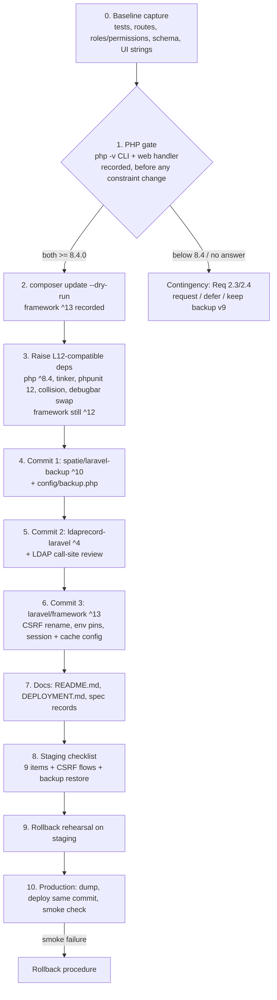

# Design Document

_Feature: `laravel-13-upgrade` — upgrading the KKDW Helpdesk from Laravel 12.68 to Laravel 13._

## Overview

This is a behavior-preserving dependency and framework upgrade. No new components, screens, tables or routes are introduced. The design is a sequenced upgrade plan in which every step is verified before the next begins, plus the small set of code and configuration edits that Laravel 13 and the upgraded packages require.

Basis for the design:

- The classic skeleton stays (Requirement 1.2). `app/Http/Kernel.php`, `app/Console/Kernel.php`, `app/Exceptions/Handler.php` and the `config/app.php` provider list are untouched, except for the CSRF middleware rename.
- The production host owner will provide PHP 8.4. The PHP gate (Requirement 2) is therefore expected to pass. It remains the first gated task and is still a recorded check, not an assumption. The blocked and decision branches (Requirement 2.3, 2.4, 2.9) stay in force as contingency only.
- The compatibility conclusions come from reading maintenance-branch `composer.json` files, not from a Composer resolve (Requirements, "Known caveat"). The `composer update --dry-run` is therefore a blocking early step, and this design is subject to correction by its output (Requirement 3.2).

### Verified code touch points

These files were read before writing this design.

| File | Current state | Change |
|---|---|---|
| `app/Http/Middleware/VerifyCsrfToken.php` | Extends `Illuminate\Foundation\Http\Middleware\VerifyCsrfToken`; `$except = []` (empty comment placeholder). | Replace with `PreventRequestForgery` in the same namespace, extending the Laravel 13 framework class. Keep the exception list empty (Requirement 4.2, already true today). |
| `app/Http/Kernel.php` (web group, ~line 43) | `\App\Http\Middleware\VerifyCsrfToken::class` between `ShareErrorsFromSession` and `SubstituteBindings`. | Swap this one entry for `\App\Http\Middleware\PreventRequestForgery::class`. Position unchanged. |
| `app/Livewire/Aduan/ReportForm.php` (~line 177) | `LdapUser::query()->select([cn, physicaldeliveryofficename, userprincipalname, telephonenumber, mobile])->findBy('samaccountname', …)` in a `try/catch (\Throwable)`; then `getFirstAttribute()` x5; `bahagianAllowed()` and `canRepresentAnyBahagian()` gate the result. `telephonenumber` falls back to `mobile`. | None expected. Edit only if the LdapRecord v4 review (Requirement 7.1) finds a changed signature. |
| `app/Http/Controllers/Api/UserController.php` (~line 65) | Same chain, selecting `cn`, `physicaldeliveryofficename`, `userprincipalname`; catches `Exception`; returns JSON `success:false` for error and for not-found. A local `User` match short-circuits the LDAP call. | None expected, same condition. |
| `app/Providers/FortifyServiceProvider.php:53` | `Cache::remember('login_stats', 600, …)` returns an array of four ints. | None. Covered by `serializable_classes` in `config/cache.php`. |
| `config/cache.php` | `prefix` is `env('CACHE_PREFIX', Str::slug(env('APP_NAME'), '_').'_cache')`. No `serializable_classes` key. | Add `serializable_classes`. |
| `config/session.php` | `cookie` is `env('SESSION_COOKIE', Str::slug(APP_NAME, '_').'_session')`. No `serialization` key. | Add `'serialization' => 'php'`. |
| `.env.example`, `.env.server`, `.env.staging` | None of them sets `SESSION_COOKIE`, `CACHE_PREFIX` or `REDIS_PREFIX`. `APP_NAME` is `Laravel` in the first two and `Sistem Meja Bantuan KKDW (STAGING)` in staging. | Pin all three variables in each file. |
| `config/backup.php` | Sources at `source.files.include` and `source.databases`; destination disks at `destination.disks`. | Diff against the v10 published config; keep current values unless the diff says otherwise (Requirement 6.1). |
| `app/Http/Controllers/BackupController.php` | Does not call spatie classes. It lists files in `storage/app/<slug(app.name)>`, and `backupFull()` calls `Artisan::call('backup:run')`. | None expected. The `backup:run` command name and the `destination.filename_prefix`/disk layout must still write into that directory. |
| `phpunit.xml` | Schema `https://schema.phpunit.de/10.5/phpunit.xsd`; `<source><include>`; `CACHE_DRIVER=array`. | Migrate to the PHPUnit 12 schema (`phpunit --migrate-configuration`), then re-validate. |
| `composer.json` | `php ^8.3`, framework `^12.0`, ldaprecord-laravel `^3.0`, backup `^9.0`, tinker `^2.9`, phpunit `^11.0.1`, collision `^8.1`, `barryvdh/laravel-debugbar ^3.7`, `platform-check: false`. | See the constraint table below. |
| `DEPLOYMENT.md` line 16, `README.md` lines 9, 34, 48 | State "PHP 8.3+" and "PHP 8.3". | Update (Requirements 2.6, 11.1, 11.2). |

Two facts differ slightly from what the requirement wording could suggest.

- `SESSION_COOKIE`, `CACHE_PREFIX` and `REDIS_PREFIX` are unset in all three env files today. Pinning therefore means adding lines, and the pinned value is the L12 slug of that file's own `APP_NAME`. The staging value differs from the example and server values.
- `config/session.php` has no `serialization` key. Laravel 12 behaves as `php` by default, so adding the key explicitly makes today's behavior permanent instead of changing it.

## Architecture

The upgrade is a pipeline of gated steps. Each step ends with a full single-run Test_Suite pass and a maintainer-made commit. The agent never commits (Requirement 8.10).



### Step ordering and rationale

The order follows Requirement 3.8 (raise everything that admits Laravel 12 first, bump the framework last) and Requirement 10.3 (three independently revertable commits).

- Both `spatie/laravel-backup ^10` (illuminate `^12.40|^13.0`, PHP `^8.4`) and `directorytree/ldaprecord-laravel ^4` (illuminate up to `^13`) install on Laravel 12. They go in before the framework bump, so a failure is attributed to one package and not to the framework. The same is expected, and must be confirmed by the dry-run, for `phpunit ^12` and `laravel/tinker ^3`.
- The `php ^8.4` constraint change goes in with, or before, the backup commit, because backup v10 needs it. It is accompanied by the `DEPLOYMENT.md` prerequisite text in the same commit (Requirement 2.6). Requirement 10.3 says the backup commit holds "only its own `composer.json` and `composer.lock` change plus the code changes that one change requires". The `php` constraint is one of those required changes, and the commit message names it.
- The framework commit comes last, so its diff is limited to the framework constraint, the CSRF rename, the env pins and the two config keys.

### Constraint plan

Target constraints are provisional until the dry-run output is recorded (Requirement 3.2, 3.3).

| Package | Before (`composer.lock`) | Target | Step |
|---|---|---|---|
| `php` | `^8.3` | `^8.4` | 3 (with commit 1) |
| `laravel/tinker` | 2.11 | `^3.0` | 3 |
| `phpunit/phpunit` | 11.5 | `^12.0` | 3 |
| `nunomaduro/collision` | 8.9 | lowest release allowing phpunit `^12` (dry-run decides) | 3 |
| `barryvdh/laravel-debugbar` | 3.16 | replaced by `fruitcake/laravel-debugbar`, `require-dev` only | 3 |
| `spatie/laravel-backup` | 9.4.1 | `^10.0` | 4 (commit 1) |
| `directorytree/ldaprecord-laravel` | 3.4.3 | `^4.0` | 5 (commit 2) |
| `laravel/framework` | 12.68 | `^13.0` | 6 (commit 3) |
| `spatie/laravel-permission` | 6.25 | stays `^6` | verify only |
| `livewire/livewire` | 3.8.6 | stays `^3` | verify only |
| `laravel/fortify` | 1.39 | stays `^1`; record whether `laravel/passkeys` is pulled | verify only |
| `laravel-lang/lang` | 12.17 | stays `^12`; confirm it resolves with framework `^13` | verify only |

`composer.json` currently has `laravel/fortify ^1.19`, `livewire/livewire ^3.0` and `spatie/laravel-permission ^6.0`, which already satisfy "stay on the branch", so no constraint edit is needed for them.

## Components and Interfaces

There are no new components. The changes below are edits to existing ones, grouped by step.

### Step 0: Baseline capture

Written to `.kiro/specs/laravel-13-upgrade/baseline/`, before any constraint changes.

- Test_Suite result: one run of `php artisan test` or `vendor/bin/phpunit`, recording tests, assertions, failures, errors, skipped, and the name of every non-passing test (Requirement 8.1).
- `php artisan route:list --json` reduced to URI, method and name, sorted, for exact comparison (Requirement 1.3).
- Role names and permission names. These are read from the seeders (the `PermissionAlreadyExists` trap means seeders are the source of truth for names) and, on staging, from the database; sorted lists, one per file.
- Database schema structure: table, column, type, nullability, index and foreign key. A schema dump from the staging MySQL 8 database after `migrate`, not from SQLite (the test database is not the production schema).
- Bahasa Malaysia interface strings: the rendered text of the login screen, aduan form, aduan show page and validation messages, plus `lang/` file contents. A script renders the screens through the test client and stores the stripped text, so the post-upgrade comparison is a plain diff.

### Step 1: PHP gate

Record, in `.kiro/specs/laravel-13-upgrade/php-gate.md`: the raw `php -v` output of the Production_Environment CLI, the raw output for the web handler (for example a temporary `phpinfo`-free probe such as `PHP_VERSION` returned by a protected, removed-after-use route or the hosting control panel's version display; the method used is recorded), the parsed `major.minor.patch`, and the check date. No constraint changes until both values are recorded and at least 8.4.0.

The owner has said 8.4 will be provided. This step still runs unchanged. If the 8.4 upgrade is not yet applied when the check runs, the host is below 8.4.0 and Requirement 2.2 holds, regardless of the assurance.

Requirement 2.7 adds a staging check: `php -v` on staging must match the production major.minor before the Laravel 13 deploy to staging. Requirement 2.9 adds a re-check if the recorded check is more than 30 days old at production deploy time.

### Step 2: Dry-run

Run `composer update --dry-run` with `laravel/framework:^13.0`, with the other targets from the constraint table, and save the full output to `.kiro/specs/laravel-13-upgrade/dry-run.md`. The file also records the pre-upgrade versions from `composer.lock` and the `illuminate/*` constraint that the resolved `livewire`, `permission` and `fortify` versions declare. If the output contradicts this design, update the requirements document first (Requirement 3.2), then this design.

### Step 3: L12-compatible dependency raise

On framework `^12`, apply `php ^8.4`, `tinker`, `phpunit`, `collision` and the debugbar swap.

- `phpunit.xml`: run `vendor/bin/phpunit --migrate-configuration`, then validate against the PHPUnit 12 schema until zero errors and zero deprecations (Requirement 3.9). The `cacheDirectory`, `<source><include>` and the existing `<server>` env entries are already PHPUnit 10+ form, so only the schema URL is expected to change.
- Deprecations from `app/`, `tests/`, `database/` and `config/` are fixed in code, not suppressed (Requirement 8.6). `vendor/` deprecations are recorded with the owning package.
- Debugbar: replace in `require-dev` only. The app must boot with `APP_DEBUG=false` (Requirement 3.6).
- Full Test_Suite pass is the gate before commit 1.

### Step 4: Commit 1, `spatie/laravel-backup ^10`

Contents: `composer.json` (`spatie/laravel-backup` and the `php` constraint), the matching `composer.lock` entries, and `config/backup.php`. Nothing else, and no framework change (Requirement 6.5).

- Diff `config/backup.php` against the v10 published config. For each added, removed or changed option, record "keep current" or "adopt v10 default" in `.kiro/specs/laravel-13-upgrade/backup-config-diff.md`.
- Sources must still cover the MySQL 8 database and `storage/`. The existing `source.files.include` and `source.databases` entries are checked, not assumed.
- `BackupController` is not expected to change. It depends only on `Artisan::call('backup:run')` and on archives appearing under `storage/app/<slug(app.name)>`. The staging run proves that the v10 destination still writes there with the same filenames.
- Verification on staging: run a backup, confirm one archive with a dump of every table and every file under `storage/`, record size and elapsed time. Restore into an empty MySQL 8 database, then confirm login, an existing user authenticating, identical aduan count and reference numbers, and at least 5 sampled attachments downloading (Requirement 6.2 to 6.4, 6.7).

### Step 5: Commit 2, `directorytree/ldaprecord-laravel ^4`

Contents: constraint and lock change, plus call-site edits if the review requires them (Requirement 7.6).

- Review the four methods the call sites use (`query()`, `select()`, `findBy('samaccountname', …)`, `getFirstAttribute()`) against LdapRecord 4 release notes and source. Record any signature, rename or return-type change in `.kiro/specs/laravel-13-upgrade/ldap-review.md` (Requirement 7.1).
- Both call sites already wrap the lookup in a catch-all and map failure to the existing Malay messages. That behavior is preserved unchanged. The two catch clauses differ (`\Throwable` in `ReportForm`, `Exception` in `UserController`), and this upgrade does not align them. If v4 throws a non-`Exception` `Error` for an unreachable server, the `UserController` clause is the one that would miss it, so the review checks which type v4 throws, and the clause is widened only if that is the case. This is a necessary fix, not a refactor.
- The Wakil BP field mapping, `bahagianAllowed()` and `canRepresentAnyBahagian()` are not modified.
- Staging uses dummy LDAP values, so real AD cannot be exercised there. Real connectivity is confirmed only by the post-deploy production smoke check (Requirement 7.7).

### Step 6: Commit 3, `laravel/framework ^13`

Contents: framework constraint and lock change, plus these edits.

1. CSRF middleware. Replace `app/Http/Middleware/VerifyCsrfToken.php` with `app/Http/Middleware/PreventRequestForgery.php`:

   ```php
   namespace App\Http\Middleware;

   use Illuminate\Foundation\Http\Middleware\PreventRequestForgery as Middleware;

   class PreventRequestForgery extends Middleware
   {
       protected $except = [
           //
       ];
   }
   ```

   Swap the single entry in `app/Http/Kernel.php`. The `$except` list is empty today and stays empty (Requirement 4.2). A repository-wide search must find no remaining `VerifyCsrfToken` reference in `app/`, `config/`, `routes/`, `tests/` or `bootstrap/` (Requirement 4.1). The exact framework class name, its `$except` property and its origin-verification hooks are confirmed from the installed Laravel 13 source after the bump, since they are not yet verified.

2. Env pins, in each of `.env.example`, `.env.server` and `.env.staging`, using that file's own `APP_NAME` and the L12 formula `Str::slug(APP_NAME, '_')`:

   | File | `APP_NAME` | `SESSION_COOKIE` | `CACHE_PREFIX` | `REDIS_PREFIX` |
   |---|---|---|---|---|
   | `.env.example` | `Laravel` | `laravel_session` | `laravel_cache` | `laravel_database_` |
   | `.env.server` | `Laravel` | `laravel_session` | `laravel_cache` | `laravel_database_` |
   | `.env.staging` | `Sistem Meja Bantuan KKDW (STAGING)` | `sistem_meja_bantuan_kkdw_staging_session` | `sistem_meja_bantuan_kkdw_staging_cache` | `sistem_meja_bantuan_kkdw_staging_database_` |

   The values are computed by running the L12 code on each file before the bump and are recorded. The table above is the expectation, not the source of truth. The real production `.env` is not in the repository, and the Production_Environment `.env` must receive the same three variables computed from its own `APP_NAME`. This is a runbook step, because the repository's `.env.server` is only a template. `REDIS_PREFIX` is pinned for completeness even though Redis is not in use (drivers are `file`, `file` and `database`).

3. `config/session.php`: add `'serialization' => 'php'` (Requirement 5.3). Cookie name logic is left as is, since the env pin controls it.

4. `config/cache.php`: add `serializable_classes`. The only cache write in the application is `login_stats`, an array of four integers with no objects, so the value `false` (no classes allowed) is sufficient. The exact option semantics are confirmed from the Laravel 13 `config/cache.php` skeleton after the bump. The reason is recorded in a comment above the key (Requirement 5.5). `CACHE_DRIVER=file` in deployed environments, so the payload is serialized to disk, and the same-contents read of an L12-written entry is verified in staging (Requirement 5.6).

5. The login-stats fallback (Requirement 5.8) is satisfied by the `Cache::remember` contract when the array payload round-trips. No new try/catch is added unless the staging check shows an unserialization error. `Cache::remember` already treats a missing or unreadable entry as a miss on the file store; a test asserts this (see Testing Strategy).

### Step 7: Documentation

- `README.md`: Laravel 13.x, PHP 8.4, Livewire 3.x, PHPUnit 12.x to major and minor as locked, in the stack summary (line 9), local requirements (line 34), staging section (line 48), and testing section. No remaining reference to Laravel 12, PHPUnit 11 or PHP 8.3.
- `DEPLOYMENT.md`: PHP 8.4 requirement (line 16), Laravel and Livewire versions, MySQL 8.0 retained, the env pin variables, the post-deploy LDAP smoke check, and the rollback procedure. No "PHP 8.3+" remains.
- Spec folder records: package diff with reasons (Requirement 11.3), verified-not-applicable items (11.4), open decisions (11.6), and the 17 Mar 2028 review deadline (1.5).

### Step 8: Staging

Deploy the exact commit that passed the Test_Suite. Run the nine-item checklist of Requirement 9.2 with the pass criteria of 9.3, plus the five CSRF flows of Requirement 4.6 through the production-equivalent proxy path, the queue check of 9.5, the Vite and Livewire asset check of 9.4, and the data-size precondition of 9.7. Results go into `.kiro/specs/laravel-13-upgrade/staging-checklist.md` with the commit hash.

Session survival (Requirement 5.4) is checked on staging by logging in on the Laravel 12 build, deploying the Laravel 13 build, and requesting an authenticated page with the same cookie.

### Step 9 and 10: Rollback rehearsal and production

See Rollback Design.

## Data Models

There are no data model changes (Requirement 1.4). The upgrade adds no application migration. The one potential exception is a migration published by an upgraded dependency, such as `spatie/laravel-backup` v10 or a Fortify release that pulls `laravel/passkeys`. If one appears, it is recorded under the dependency's name and accepted by the maintainer before deploy. Otherwise the schema comparison against baseline must show zero differences.

Configuration state that must be stable across the upgrade:

| Item | Laravel 12 value | Laravel 13 value | How it is held |
|---|---|---|---|
| Session cookie name | `<slug_>_session` | identical | `SESSION_COOKIE` pinned in env |
| Cache key prefix | `<slug_>_cache` | identical | `CACHE_PREFIX` pinned in env |
| Redis key prefix | `<slug_>_database_` | identical | `REDIS_PREFIX` pinned in env |
| Session serialization | `php` (implicit) | `php` | explicit key in `config/session.php` |
| `login_stats` payload | `array{total:int,resolved:int,rate:int,bahagian:int}` | same, readable | `serializable_classes` in `config/cache.php` |

## Correctness Properties

*A property is a characteristic or behavior that should hold true across all valid executions of a system-essentially, a formal statement about what the system should do. Properties serve as the bridge between human-readable specifications and machine-verifiable correctness guarantees.*

Only a small part of this upgrade suits property-based testing. Most criteria are one-time migration steps, infrastructure, or configuration checks. These are verified by example, integration or smoke tests (see Testing Strategy). The three properties below are the ones the requirements document identifies as varying meaningfully with input in application code.

Reflection: P1 (stored identity mapping) and the LDAP-to-form mapping at the call site are separate. P1 starts from form fields and checks storage and display, while P2 starts from an arbitrary username and checks the lookup result. P3 concerns cache keys. No property implies another, and none is merged.

### Property 1: Wakil BP field mapping is an invariant

*For any* aduan submitted through `ReportForm` with any combination of `is_bp` and `bp_*` complainant fields, the complainant name, email and telephone stored on the aduan SHALL be the represented person's values when `is_bp` is set, and the submitter's own values otherwise. The authenticated submitter SHALL be stored as the Wakil only when `is_bp` is set. The aduan show screen, the aduan listing and the notification e-mail SHALL present the same complainant identity that was stored, and SHALL identify the submitter separately as the Wakil. No value swaps between the two identities in either direction.

**Validates: Requirements 7.5, 7.9**

### Property 2: LDAP lookup never raises and maps attributes faithfully

*For any* `samaccountname` string, including the empty string, over-length strings, and strings containing LDAP filter metacharacters (`*`, `(`, `)`, `\`, NUL), the LDAP_Lookup against a stubbed directory SHALL return either a resolved attribute set or a null result, with the matching Malay error message and empty Wakil BP identity fields, and SHALL NOT raise an unhandled exception. *For any* stubbed entry that matches exactly one `samaccountname`, the lookup SHALL return, for each attribute the call site selects, the same single string as the Laravel 12 implementation returns for the same stub data, and `telephonenumber` empty SHALL resolve the telephone from `mobile`. *For any* stub that simulates a connection or bind failure, the lookup SHALL make a single attempt and map to the "cannot connect to AD" message while retaining the values already entered in the form.

**Validates: Requirements 7.2, 7.3, 7.4, 7.8**

### Property 3: Cache key prefixing is stable

*For any* cache key string, the fully qualified key produced under the pinned `CACHE_PREFIX` SHALL equal the key produced by the Laravel 12 configuration for the same input, and SHALL contain none of the hyphenated forms `-session`, `-cache-` or `-database-` introduced by the Laravel 13 default prefixes.

**Validates: Requirements 5.1, 5.2**

## Error Handling

| Condition | Behavior | Source |
|---|---|---|
| Production PHP below 8.4.0, or either version unrecorded | No constraint or lock change. Contingency decision (a) request, (b) defer, or (c) keep backup v9 with an alternative backup arrangement. | Req 2.2, 2.4, 6.6 |
| Production PHP version unobtainable within 10 working days | Record the dates and the absence of a response, then treat as below 8.4. | Req 2.3 |
| Dry-run reports an undocumented conflict, or a package resolves outside its constraint | Update `requirements.md`, then design, before further changes. | Req 3.2 |
| No network access to Packagist | Stay blocked before the first constraint change and record that conclusions are unverified. | Req 3.10 |
| Test_Suite failure after a package is raised | Restore that package to its recorded version, record the failing tests, raise nothing further. | Req 3.11, 8.3 |
| `laravel-lang/lang ^12` does not resolve with framework `^13`, or messages fail to render | Record the resolving version, or decide to remove the package with a replacement message source. | Req 3.12 |
| Post-upgrade routes, roles, permissions, strings or schema differ from baseline | Not complete and not deployed until each difference is reverted, or recorded and accepted. | Req 1.8 |
| State-changing request with `Sec-Fetch-Site: cross-site` | HTTP 419, no data change, log entry with the path. | Req 4.4 |
| State-changing request with no `Sec-Fetch-Site` header | Decided by CSRF token only. | Req 4.5 |
| Any of the five flows returns 419 on staging or production | Mitigate, preferring trusted-origin configuration over disabling origin verification, and record the residual risk. | Req 4.7 |
| Session cookie, cache prefix or Redis prefix differs between L12 and L13 | Verification failed, no deploy, report which setting and both values. | Req 5.7 |
| `login_stats` unreadable after deploy | Treated as a cache miss, recomputed and stored for 600 seconds, page renders without error. | Req 5.8 |
| Backup run errors, produces no archive in 60 minutes, or fails the content check | Record the step, keep backup at 9.4.1 in `composer.lock`, block production until a round trip passes. | Req 6.8 |
| LDAP no match | `null`, message "Pengguna tidak dijumpai", Wakil BP fields empty. | Req 7.3 |
| LDAP unreachable, bind rejected, or over 10 seconds | Single attempt, message "Tidak dapat connect ke AD. Sila hubungi admin", form values retained, non-Wakil submission still works. | Req 7.4 |
| Looked-up bahagian empty or different, and the submitter lacks the represent-any permission | Message "Anda hanya boleh mewakili pengguna dari bahagian anda sahaja", fields empty. | Req 7.8 |
| Staging checklist item fails | Block production. Re-run the failed item and every item on its screen on a rebuilt staging deploy. | Req 9.6 |
| Production post-deploy smoke check fails | Execute the rollback procedure inside the maintenance window and record the failed item. | Req 10.7 |

The LDAP 10-second timeout (Requirement 7.4) is controlled by the LdapRecord connection configuration (`config/ldap.php` timeout and retry settings), not by new application code. The Step 5 review confirms the timeout option name and that no retry occurs under v4. Any change needed is confined to configuration.

## Rollback Design

Rollback is designed around three independently revertable commits and a deliberate decision to keep all state-bearing settings identical across both framework versions.

### Why no flush is needed in either direction

- `SESSION_COOKIE`, `CACHE_PREFIX` and `REDIS_PREFIX` hold the pinned Laravel 12 values on both revisions.
- Session `serialization` is `php` on both revisions.
- `login_stats` is a plain array readable by both.

Sessions and cache therefore survive a revert to Laravel 12 with no store flush (Requirement 10.5). The Laravel 12 revision must carry the pinned env variables, which it ignores harmlessly because it reads the same `SESSION_COOKIE` and `CACHE_PREFIX` keys.

### Preconditions at production deploy (Requirement 10.2)

- A gzipped database dump and a `storage/` uploads tarball, each taken no more than 60 minutes before the deploy. They are stored outside the repository working tree, each passes a decompression check (`gzip -t`, `tar -tzf`), and both are kept for at least 14 days after sign-off.
- The Laravel 12 git revision to return to, recorded by commit hash.
- The Laravel 12 `composer.lock` is available at that revision.
- The aduan count immediately before the deploy is recorded (Requirement 10.8).

### Ordered rollback procedure (recorded in `DEPLOYMENT.md`)

1. Enable maintenance mode (`php artisan down`).
2. `git checkout <laravel-12-commit-hash>`.
3. `composer install --no-dev --optimize-autoloader`, installing from the restored Laravel 12 `composer.lock`.
4. If the host PHP was raised to 8.4 for this upgrade and must go back, revert it to the version recorded under Requirement 2. Note that this is only needed when the Laravel 12 revision cannot run on 8.4. Laravel 12 supports 8.4, so the host version normally stays on 8.4 and this step is skipped.
5. If a dependency-supplied migration was applied during the deploy, run `php artisan migrate:rollback --step=<n>`. If that is not possible, restore the pre-deploy database dump.
6. `php artisan optimize:clear`, which runs the cache, config, route and view clears (`cache:clear`, `config:clear`, `route:clear`, `view:clear`), then the usual `config:cache` and `route:cache` as in the normal deploy.
7. `php artisan up`.
8. Verify login works and the aduan count equals the pre-deploy figure.

Because the three commits are independent, a partial rollback is possible. For example, if only the LDAP lookup fails in production, the LdapRecord commit can be reverted alone while the framework commit remains. This applies only when the reverted package version is compatible with the framework version that stays installed, which is true for LdapRecord v3 on Laravel 13 only if the dry-run showed that v3 allows `illuminate ^13`. The runbook states which partial reverts the dry-run confirmed, and defaults to a full revert.

### Rehearsal (Requirement 10.4, 10.6)

Execute the procedure on staging after the checklist passes. Confirm the revision, an installed framework version in 12.x, and a passing Test_Suite. Record the elapsed time. If it exceeds 60 minutes, record the slow steps and shorten them before production is scheduled.

## Risk Table

This table matches the risk assessment in the Requirements Introduction and adds the mitigation each part of the design provides.

| Area | Risk | Where the risk lies | Mitigation in this design |
|---|---|---|---|
| Application code | LOW | CSRF rename, two config keys, env pins | Small diff, isolated in commit 3, covered by tests |
| Livewire and `spatie/laravel-permission` | LOW | Stay on `^3` and `^6`, both admit `illuminate ^13` | Dry-run records the resolved versions and their illuminate constraints |
| `spatie/laravel-backup` v10 | MEDIUM | Config changes, PHP 8.4 requirement, restore integrity | Own commit, config diff record, backup and restore round trip with attachment sampling on staging |
| `directorytree/ldaprecord-laravel` v4 | MEDIUM | Verifiable only against real AD in production | Own commit, emulator-based tests, API review record, post-deploy LDAP smoke check, runbook note |
| CSRF `Sec-Fetch-Site` behavior | MEDIUM | Proxy may alter or strip the header | Five-flow staging test through the production proxy path, header presence recorded, trusted-origin mitigation preferred |
| Production PHP 8.4 availability | MEDIUM to HIGH, potential hard blocker | Host owner must supply PHP 8.4. The owner has said it will. | PHP gate is the first gated task, still recorded and still blocking. Contingency decisions are kept, not weakened. |

## Testing Strategy

### Approach

The suite is run by the maintainer before each commit. The agent hands over the single-run command (`php artisan test`) and waits for confirmation. The agent does not create commits (Requirement 8.10). At each of steps 3, 4, 5 and 6, a full run must show zero failures and zero errors beyond the recorded baseline before the next step.

Existing test conventions are kept, and not modified when a touched test is merely adjusted (Requirement 8.8):

- `Livewire::test` assertion style and Livewire exception-handling style are unchanged. Memory of this repository records that Livewire component exceptions are handled in a particular way in feature tests, so new Livewire tests copy an existing test in `tests/Feature/Livewire` or `tests/Feature/Aduan` as a template.
- Date-column database assertions follow the existing style used in tests that compare date columns.
- Seeding in tests must tolerate existing records, so that a fresh in-memory SQLite database never raises `PermissionAlreadyExists` (Requirement 8.7). New tests reuse the repository's existing seed helper, which uses first-or-create semantics for permissions and roles. They do not call `Permission::create` directly.
- If a pattern fails under PHPUnit 12, the smallest change is applied to the affected test methods only, and reported to the maintainer before the commit point (Requirement 8.9).
- No test file is deleted, no test method is emptied, and no previously passing test is skipped (Requirement 8.5). The test file count stays at 52 or higher, and the test count at or above baseline.

### Property-based tests

Properties P1 to P3 are implemented, one test per property, with a property-testing library. PHP has no built-in property testing, so `giorgiosironi/eris` is proposed as a `require-dev` addition, and its PHPUnit 12 compatibility is checked by the same dry-run. The addition is a test-only dependency in the step 3 commit set. If Eris does not support PHPUnit 12, the fallback is recorded and the maintainer chooses between another library and generator-driven PHPUnit data providers. Property-based testing is not implemented from scratch.

Each property test runs at least 100 iterations and carries a tag comment of the form `Feature: laravel-13-upgrade, Property <n>: <property text>`.

| Property | Test location | Generator | Stub/fixture |
|---|---|---|---|
| P1 Wakil BP mapping | `tests/Feature/Aduan/` | `is_bp` boolean, random name, email, telephone for represented person and submitter | `Livewire::test(ReportForm::class)` with an authenticated submitter. Uses a local `User` match for the represented person, so no LDAP call is needed. Asserts the stored `Report`, the show view and the notification mail content. |
| P2 LDAP lookup | `tests/Feature/Api/` and `tests/Feature/Aduan/` | arbitrary strings, including empty, over-length and filter metacharacters; random attribute presence | LdapRecord `DirectoryEmulator` (`LdapRecord\Laravel\Testing\DirectoryEmulator::setup()`) with fake entries. The connection-failure case uses an emulated exception. |
| P3 Cache prefix | `tests/Unit/` | arbitrary key strings | Computes the fully qualified key from the pinned prefix and compares it with the L12 formula `Str::slug(APP_NAME, '_').'_cache'`, plus a hyphen-absence check. |

P2 runs against the emulator. The emulator is part of `ldaprecord-laravel`, and its v4 API is confirmed in the step 5 review. The existing tests, if any, for the two call sites are extended rather than duplicated.

### Example-based tests

CSRF origin behavior (Requirement 4.8), against one state-changing `web` route, for example an authenticated feature POST:

1. Same-origin: valid token and `Sec-Fetch-Site: same-origin` reaches the handler and does not return 419.
2. Cross-site: `Sec-Fetch-Site: cross-site` returns 419, makes no data change, and writes a log entry with the path.
3. Absent header: no `Sec-Fetch-Site`, so the decision is on token validity alone, in two sub-cases (valid token passes, invalid token returns 419).

The framework skips CSRF checks when running unit tests. These tests must bypass that skip, for example by running the request under a non-testing environment name for the test duration, and the exact mechanism is confirmed against the installed `PreventRequestForgery` source after the bump. It is recorded in the test as a comment.

Other example and integration checks:

| Check | Type | Requirement |
|---|---|---|
| `login_stats` written by L12 is read by L13 with the same contents | Staging check. Unit-level: a pre-seeded array entry on the file store round-trips with `serializable_classes` set. | 5.5, 5.6 |
| Unreadable `login_stats` is treated as a miss and recomputed | Unit test with a corrupted entry on the file store | 5.8 |
| Session cookie, cache prefix, Redis prefix equal between L12 and L13 | Smoke script comparing values resolved from each env file | 5.1, 5.2, 5.7 |
| Existing session cookie from L12 accepted by L13 | Staging check | 5.4 |
| Backup screen access and non-permitted user denied | Feature test in `tests/Feature/Backup` (existing directory) | 6.2, 6.9 |
| Backup archive content, restore, attachment download | Staging integration check | 6.3, 6.4, 6.7 |
| `ReportForm` LDAP error messages for not found, bahagian mismatch, connection failure | Feature tests with `DirectoryEmulator`, in addition to P2 | 7.3, 7.4, 7.8 |
| Route, role, permission, schema and string comparison against baseline | Scripted diff, recorded | 1.3, 1.4, 1.8 |
| App boots on framework 13.x and with debug disabled | Smoke test (`tests/Feature/SmokeTest.php` exists) | 1.7, 3.6 |
| Notification queue dispatch within 60 seconds | Staging integration check | 9.5 |
| Real AD lookup | Production smoke check only | 7.7 |

Infrastructure, deployment and host checks (PHP gate, staging checklist, rollback rehearsal, production smoke) are recorded procedure outputs, not automated tests, because property-based testing does not apply to them.

### Test execution and gating summary

| After step | Run | Pass condition |
|---|---|---|
| 0 Baseline | Full suite, Laravel 12 | Recorded as the baseline |
| 3 L12-compatible deps | Full suite | Zero new failures or errors, `phpunit.xml` schema valid |
| 4 Backup commit | Full suite plus staging backup round trip | Zero new failures, round trip recorded |
| 5 LdapRecord commit | Full suite | Zero new failures, review recorded |
| 6 Framework commit | Full suite | Zero failures and errors, test count at or above baseline, CSRF tests pass |
| 8 Staging | Checklist | All nine items passed, commit hash recorded |
| 9 Rehearsal | Full suite on rolled-back staging | Zero failures, 12.x installed |

## Assumptions and open items

- PHP 8.4 will be available on production, per the user. This is not recorded as fact until the Step 1 output exists.
- The target constraints, the `PreventRequestForgery` class name and `$except` semantics, the `serializable_classes` option semantics, and the Eris compatibility with PHPUnit 12 are all unverified until the dry-run and the installed Laravel 13 source are consulted. Each is flagged where it appears.
- The production `.env` is outside the repository. The three prefix variables must be added to it by the runbook, computed from its real `APP_NAME`.
